# StaffPilot

Built by **Seven Team-5374** for IE5374 Applied Generative AI, Module 7 Hackathon, Topic 3: Dynamic Agent Staffing Optimization (a problem contributed by Google).

StaffPilot plans how many support agents each of 22 countries needs in each month of the year, and puts the plan in a manager's hands through a web app with a GenAI assistant, a scenario explorer and a memo writer. A language model reads the manager's words and writes the answers; every number comes from the optimizer and a day by day simulator.

| Deliverable | Link |
|---|---|
| GitHub repository | https://github.com/lequo-neu/staffpilot |
| Executed notebook | [`notebooks/StaffPilot_Topic3.ipynb`](notebooks/StaffPilot_Topic3.ipynb) |
| Analysis report | [`docs/report.md`](docs/report.md) |
| Demo video (3 minutes) | `<to be added>` |
| Methods in detail | [`docs/METHODS.md`](docs/METHODS.md) |
| Evaluation in detail | [`docs/EVALUATION.md`](docs/EVALUATION.md) |
| Presentation script | [`docs/PRESENTATION.md`](docs/PRESENTATION.md) |

Topic confirmed via email with Ms. Niki on 3 November 2026.

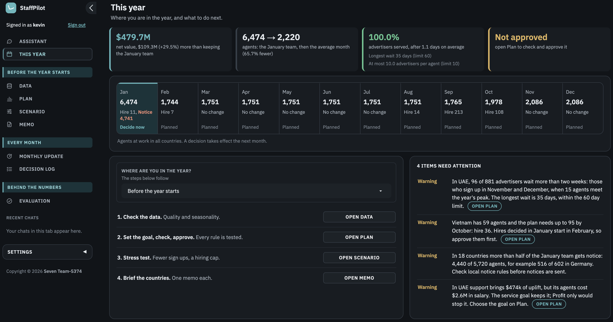

## The answer

On 1 January the 22 countries employ 6,474 agents, while the busiest 60 days of demand need about 2,333. The plan gives 4,741 notices in January, hires a few agents back before the fourth quarter peak and grows Vietnam, the only short country, from 59 to 95 agents.

| | Keep the January team | StaffPilot plan |
|---|---|---|
| Net value of the year | $370.4M | **$479.7M** (+$109.3M, +29.5%) |
| Agents in an average month | 6,474 | **2,220** (65.7% fewer) |
| Eligible advertisers served | 99.3% | **100.0%** |
| Average wait for an agent | 1.1 days (longest 60) | **1.1 days** (longest 35, limit 60) |
| Agent utilization | 23.9% | **68.9%** |
| Most advertisers per agent on any day | 10 | **10** (limit 10) |

Planned from 2024 alone and scored on what really happened in 2025, the method reaches 99.3% of the value of a plan made with hindsight. All numbers use the course dataset (sign ups for 2024 and 2025, staffing as of January 2026, as the teaching team confirmed), so the plan covers 2026; the brief's text names 2023, 2024 and 2025, and the code always plans the year after the last sign up.

## What the brief asks, and the evidence

| ID | Brief | What StaffPilot does | Proof |
|---|---|---|---|
| R1, R2 | A dynamic month by month plan per country | 22 countries by 12 months: agents at work, hires and notices, with their dates | `outputs/plan.csv`; This year and Plan pages |
| R3 to R11 | Eligibility: budget exceeds the country threshold | strictly greater (13 budgets sit exactly on one) | Data page, data quality note |
| R3 to R11 | At most 10 advertisers per agent; 60 days of support; 60 days in the pool | applied day by day by the simulator, which produces every reported number | Check the plan: 8 of 8 pass, no day above 10 |
| R3 to R11 | One month of ramp up; one month of notice at 40% of salary | hires work from the next month; notices end after one month and cost 40% | Check the plan; How it is calculated |
| R3 to R11 | Uplift of 0 to 25% with the given probabilities | expected uplift 13.5% on the projected annual budget | How it is calculated |
| R12 | Cost efficiency, timely support, scalability | net value maximized; utilization 68.9% (from 23.9%); mean wait 1.1 days; monthly hires and notices | Plan cards; service goals |
| R13 | Analysis and justification | key decisions, assumptions and their impact | [`docs/report.md`](docs/report.md) |
| R14 | Sensitivity to sign up volume | sign ups from 70% to 130% of forecast, Monte Carlo with 20 runs, what if scenarios | report section 5; notebook section 10; Scenario page |
| R15 | Other considerations | monthly update with actual sign ups, lower thresholds, the UAE, notice rules, pool fairness | report section 6; Monthly update page |
| R16 | The provided data, easy to swap for another file | every sign up with its budget; the planning year follows the data; one line in the config | `tests/test_dataset_swap.py` |
| R17 to R22 | A GenAI app with at least two course techniques | six: API calls, prompt engineering, structured output, LangChain, RAG, agents | How it works, below |
| R26 to R29 | Notebook, README with setup, diagram and contributions, AI use | executed notebook; this file; [`docs/AI_USAGE.md`](docs/AI_USAGE.md) | links above |

### The plan, and the checks that it follows the rules

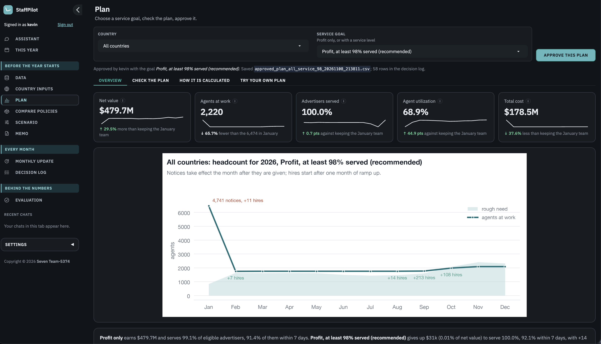

The Plan page shows the headline numbers with their change against keeping the January team, and the headcount month by month. **Check the plan** tests the plan against every rule of the brief, with the numbers behind each check:

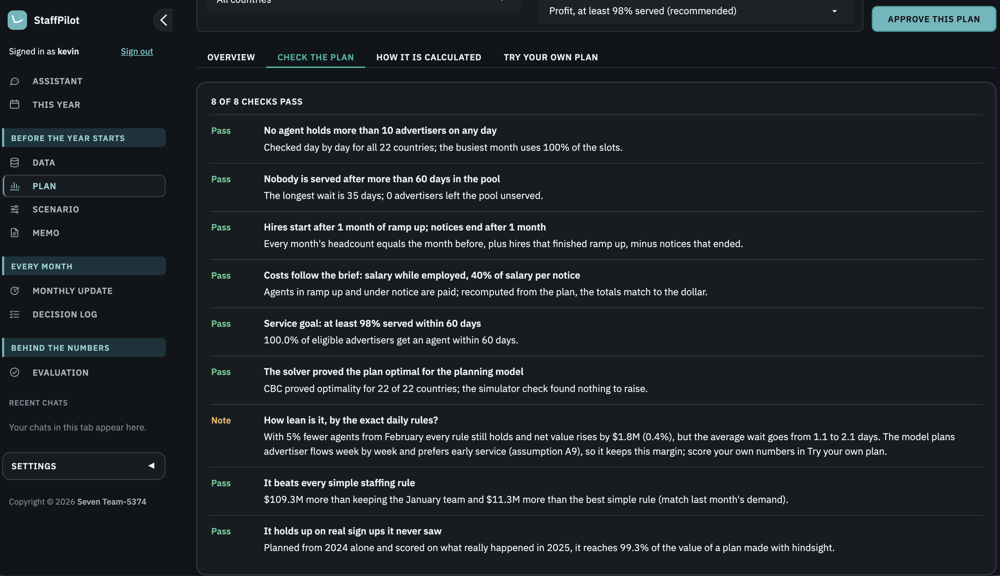

### The data the plan stands on

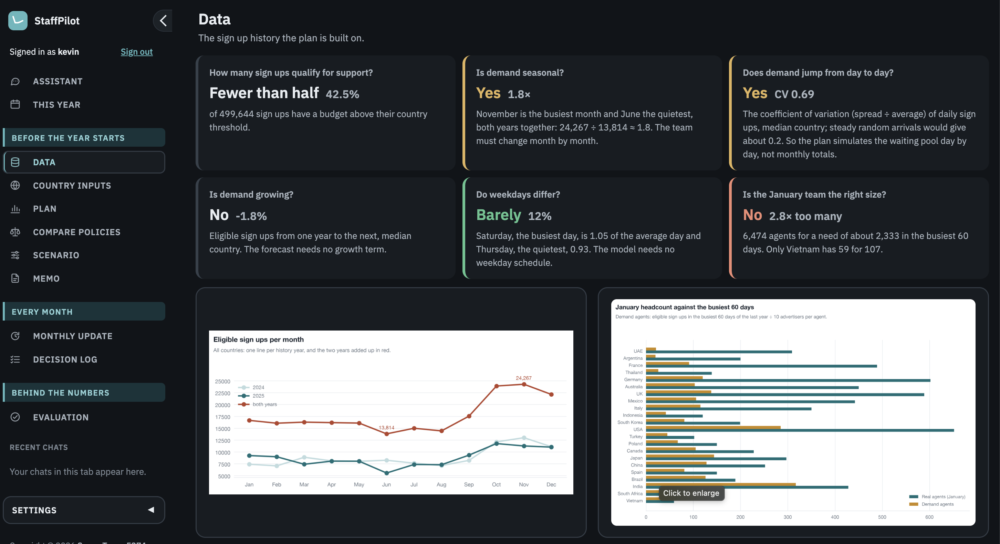

Demand is seasonal (November is 1.8 times June), jumps from day to day (coefficient of variation 0.69, so the waiting pool is simulated day by day), is not growing (minus 1.8% a year) and barely differs by weekday. The January team is 2.8 times what the busiest 60 days need.

### Sensitivity and what if

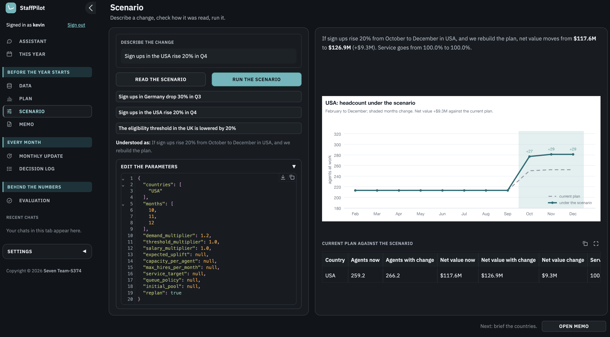

"Sign ups in the USA rise 20% in Q4" is read into parameters the manager can check and edit; the rebuilt plan moves USA net value from $117.6M to $126.9M and adds 27 to 29 agents from October. Across all countries, scaling sign ups from 70% to 130% of forecast shows when replanning pays: below forecast it saves money, above it keeps the wait at a day where the unchanged plan lets it grow to 22 days.

### The GenAI application

| Assistant: plain English questions, with follow ups | Memo: one page per country manager |
|---|---|
| 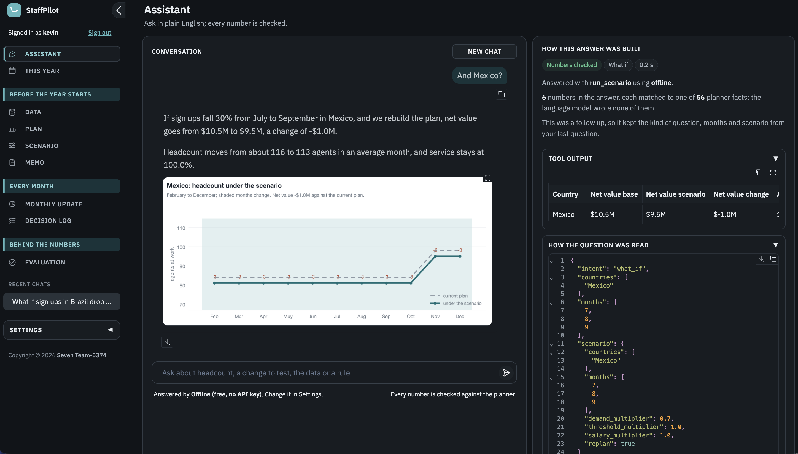 | 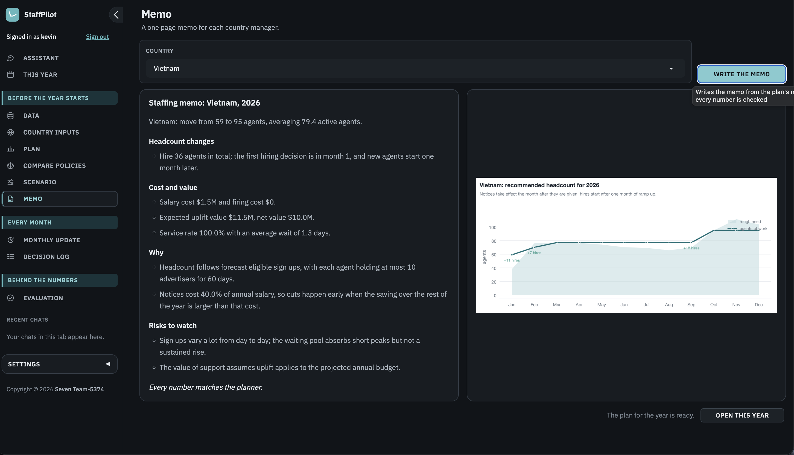 |

The assistant answered "And Mexico?" after a question about Brazil by keeping the scenario and changing the country. The panel on the right shows how: 6 numbers in the answer, each matched to one of 56 planner facts, and the question as it was read.

## Beyond the brief

| Feature | Why it matters | Proof |
|---|---|---|
| **Number check on every answer** | the language model never writes a number; it writes `{{Brazil.hires}}`, the planner fills it, and any number with no source, or from another country, is rejected | no answer in the app reaches the user with an unchecked number; Claude passes on the first draft on all 72 main and holdout questions |
| **Profit only against a service level** | the manager chooses the goal; each goal is its own optimization | 98% served costs $0.03M; 98% within 7 days costs $3.6M and 87 agents |
| **The manager can check the plan** | net value rebuilt from its inputs; any headcount scored by the same simulator | $658.1M uplift minus $91.7M salary minus $86.7M notices = $479.7M |
| **Monthly update with actual numbers** | the months done keep their decisions; only the rest is solved again | USA, 20% more sign ups by March: hire 39 instead of 0 |
| **Decision log** | what the optimizer or a model proposed, what changed it, what was applied, and who approved | `outputs/decision_audit.csv` |
| **Multi LLM evaluation with a holdout** | 82 labelled questions, new wording held out, cross model judges, a person's grades to check the local judges | Claude 100%, Gemma 88%, GPT 5 nano 84%, keywords 28% |
| **Backtest on real sign ups** | the method is scored on a year it never saw | 99.3% of hindsight value |
| **Works with no API key** | a keyword router and templates run the same pipeline, free and repeatable | the notebook, tests and CI run offline |
| **Sign in** | each approval names its user | first password must be changed |

| Service goal: profit against speed | How it is calculated |
|---|---|
| 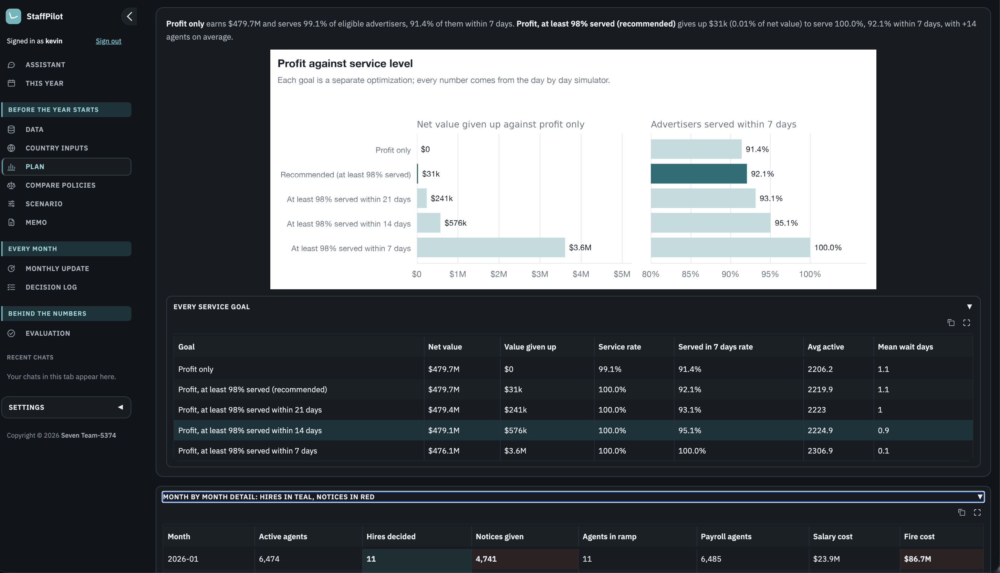 | 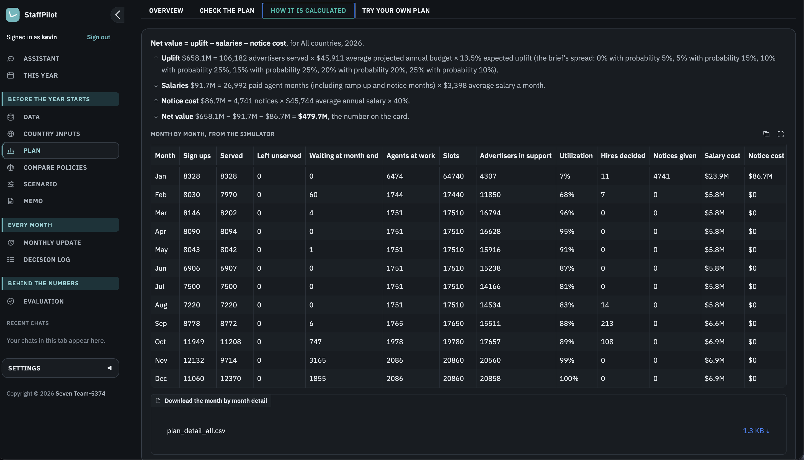 |
| **Try your own plan** | **Monthly update** |
| 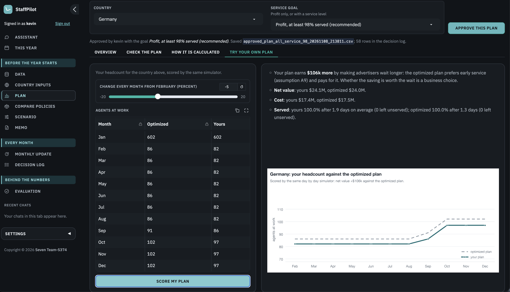 | 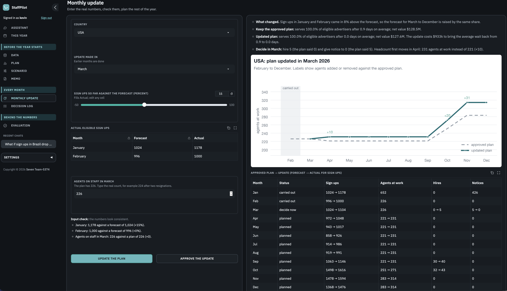 |
| **Decision log** | **Evaluation** |
| 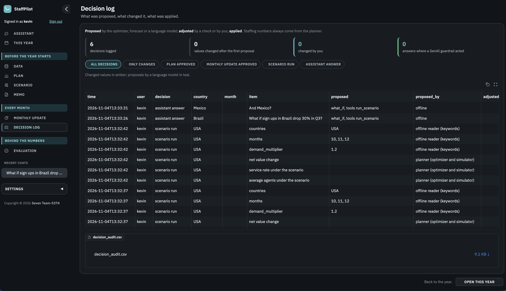 | 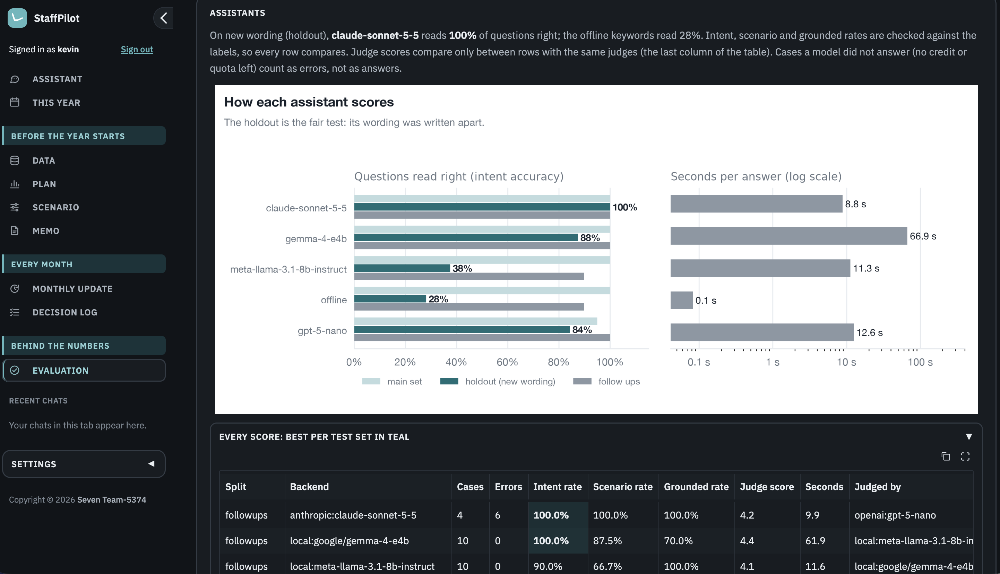 |
| **Sign in** | **Any chart opens full size** |
| 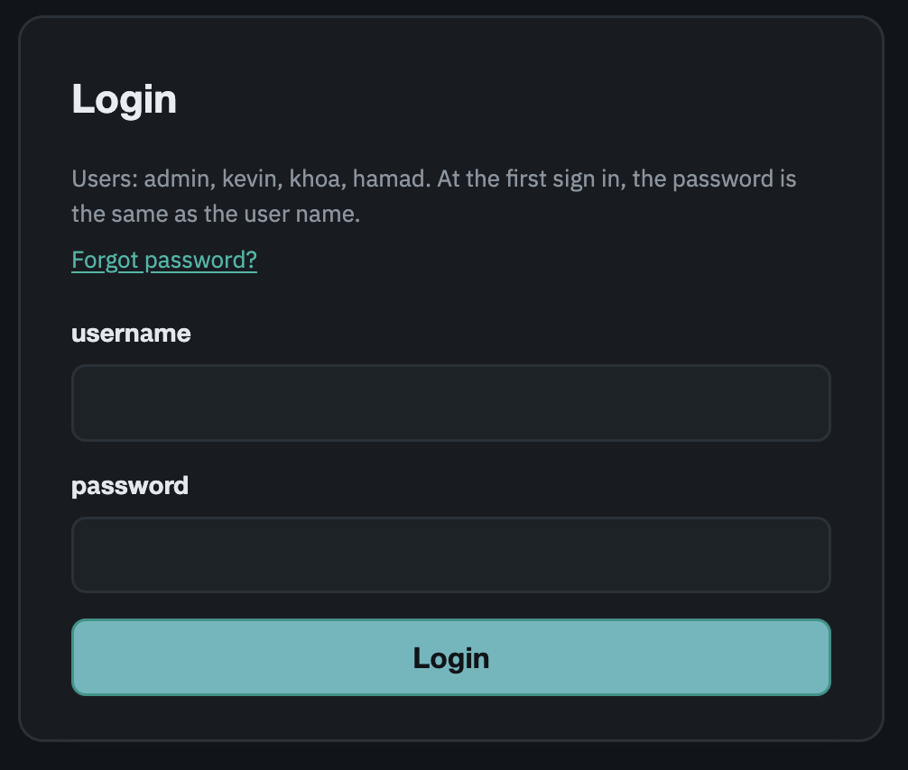 | 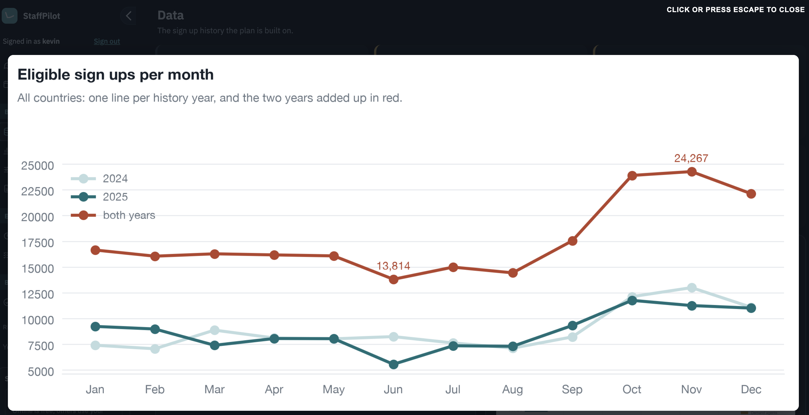 |

## How it works

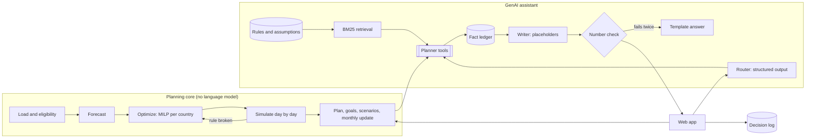

**Planning core.** The same inputs always give the same plan.

1. **Load** (`data.py`): reads the workbook, keeps sign ups whose budget is above the threshold, and moves 920 impossible dates (29 February in a normal year) to the last day of the month.
2. **Forecast** (`forecast.py`): eligible sign ups per country and month by one of three seasonal methods (last year repeated, the seasonal mean of the history years, or the seasonal mean scaled by growth), chosen by a backtest on the last year.
3. **Optimize** (`optimize.py`): one mixed integer program per country, solved by CBC. It decides hires and notices per month, tracks advertisers per week, and maximizes uplift minus salaries and notice cost, with three months of lookahead so December is not cut only because the year ends.
4. **Simulate** (`simulate.py`): replays the plan day by day under the brief's rules. Every reported number comes from here. When a day breaks a rule, the planner raises that month's headcount and solves again.
5. **Compare and update** (`planner.py`, `monthly.py`): the same pipeline gives the baselines, the service goals, the scenarios, the sensitivity table and the monthly update.

Net value = uplift minus salaries minus notice cost. Uplift = advertisers served times their projected annual budget times 13.5%, the expected value of the brief's distribution.

**GenAI assistant.** The model decides what to run and how to say it; the planner provides every number.

1. **Route**: a model reads the question into a typed request (intent, countries, months, scenario changes) through structured output; a bad reply is repaired field by field.
2. **Run tools**: six LangChain tools call the planner; rule questions use BM25 retrieval over the case rules and assumptions.
3. **Write and check**: the writer uses placeholders such as `{{Brazil.hires}}`; the fact ledger fills them and rejects any number with no source. A failed draft is retried once, then replaced by a template answer.

| Course technique | Where |
|---|---|
| API calls | OpenAI, Anthropic, Google and local models through LangChain (`agent/backends.py`) |
| Prompt engineering | router, answer, memo and judge prompts |
| Structured output | Pydantic `RoutedQuery`, `ScenarioParams`, `MemoDraft`, `Judgement` |
| LangChain | six `StructuredTool`s, conversation memory, `create_agent` chat |
| RAG | BM25 over `src/staffpilot/knowledge/` with citations |
| Agents | a structured assistant that routes to one tool, and a `create_agent` chat that chains tools |

Each step, the design choices and the numbers behind them: [`docs/METHODS.md`](docs/METHODS.md).

## Assumptions

The brief leaves some points open. Where its words point one way we take the literal reading; otherwise we take the reading that makes the result look worse, so the headline is not inflated. The five that matter most:

| | Assumption | If changed |
|---|---|---|
| A1 | Uplift applies once to the projected annual budget | counted only for the 60 days of support, every policy loses money, yet the plan still beats keeping the team by $111M |
| A2 | Eligible means a budget strictly above the threshold ("exceeds") | 13 sign ups sit exactly on one |
| A3 | The pool is empty on 1 January, as the brief says | with the last 60 days still waiting: $606.3M |
| A5 | Agents under notice are paid that month and take no new advertisers | an unpaid notice month would save at most $18.2M |
| A9 | The optimizer prefers early service | without it: $482.8M, but the mean wait rises from 1.1 to 3.0 days |

All eleven, with the reasons: [`docs/METHODS.md`](docs/METHODS.md#assumptions).

## Evaluation of the assistant

82 labelled questions: 40 in the main set, 32 in a holdout written in new words, and 10 follow ups. The holdout is the fair test, because the offline keywords were written while looking at the main set.

| Holdout (32) | Intent read right | Scenario fields right | Passed the number check first time | Seconds | Cost per question |
|---|---|---|---|---|---|
| Claude Sonnet 5.5 | **100%** | **100%** | **100%** | 8 | $0.016 |
| Gemma 4 E4B (local) | 88% | 67% | 75% | 66 | free |
| GPT 5 nano | 84% | 100% | 84% | 12 | $0.001 |
| Llama 3.1 8B (local) | 38% | 11% | 94% | 11 | free |
| Offline keywords | 28% | 0% | 100% | 0.0 | free |

A language model router is far better than keywords on new wording, and no unchecked number reaches the user from any of them. Judge scores, tokens, the follow up set, the local and online runs, and a check of the AI judge against a person's grades of 30 answers are in [`docs/EVALUATION.md`](docs/EVALUATION.md).

## Run it

Python 3.11 to 3.13. Save the course dataset as `data/raw/IE5374_Hackathon_Google_Data.xlsx`, then:

```bash
python3.12 -m venv .venv
source .venv/bin/activate
pip install -e ".[dev,notebook]"
python -m staffpilot app
```

On Windows (PowerShell), create and activate the environment with `py -3.12 -m venv .venv` and `.venv\Scripts\Activate.ps1`; the other two lines are the same.

The app opens at http://127.0.0.1:7860. Sign in as `admin`, `kevin`, `khoa` or `hamad`; the first password is the user name, and the app then asks for a new one. Without an API key the assistant runs offline, free. Other commands (`plan`, `ask`, `memo`, `update`, `eval`), Windows steps and API keys: [`docs/SETUP_GUIDE.md`](docs/SETUP_GUIDE.md). Checks before a submission: [`docs/TESTING_GUIDE.md`](docs/TESTING_GUIDE.md).


## Team contributions

Share of the work: **Kevin 40%**, **Hamad 30%**, **Khoa 30%**. All three reviewed the plan, the assumptions and the report.

| Step | Task | Main file | Owner | Status |
|---|---|---|---|---|
| 01 | Prepare and check the data: eligibility, date repair, data profile | `src/staffpilot/data.py`, `eda.py` | Kevin | Done |
| 02 | Forecast demand and backtest the method | `forecast.py`, `backtest.py` | Kevin | Done |
| 03 | Turn the brief's rules into the planning model: capacity, waiting pool, ramp up, notice, costs | `default_config.toml`, `optimize.py` | Hamad & Kevin | Done |
| 04 | Simulate day by day and check the plan against every rule | `simulate.py`, `checks.py` | Hamad & Kevin | Done |
| 05 | Define the KPIs and the service goals of the Plan page | `planner.py` | Hamad | Done |
| 06 | Write the assumptions A1 to A11 and test how much each one matters | `docs/METHODS.md`, notebook section 11 | Hamad & Khoa | Done |
| 07 | Design the what if scenarios, the sensitivity and Monte Carlo runs, and read their results | `scenarios.py`, notebook section 10 | Khoa | Done |
| 08 | Build the GenAI assistant: routing, planner tools, retrieval, number check, memory | `src/staffpilot/agent/` | Kevin | Done |
| 09 | Write the labelled test questions and check every label | `eval/testset.jsonl`, `holdout.jsonl`, `followups.jsonl`, `label_review.csv` | Khoa & Hamad | Done |
| 10 | Build the evaluation and compare the models | `evaluation.py`, `docs/EVALUATION.md` | Kevin | Done |
| 11 | Build the web app: pages, monthly update, decision log, sign in | `app.py`, `src/staffpilot/ui/` | Kevin | Done |
| 12 | Check the plan against real capacity planning practice and write the business recommendations | `docs/report.md` | Khoa | Done |
| 13 | Write the process improvement view | `docs/report.md` | Hamad | Done |
| 14 | Run the testing guide before submission | `docs/TESTING_GUIDE.md` | Khoa & Hamad | Done |
| 15 | Executed notebook, README and CI on three systems | `notebooks/StaffPilot_Topic3.ipynb`, `.github/workflows/ci.yml` | Kevin | Done |
| 16 | Presentation script and demo video | `docs/PRESENTATION.md` | Khoa & Kevin | Video to be recorded |

| Member | Role | Background |
|---|---|---|
| **Quoc Hung Le (Kevin)** | Team lead, solution architect and lead engineer | data analytics and BI at Viettel and Samsung: ETL, workforce dashboards, forecasting |
| **Hamad Al Sulaimi** | Optimization and process analysis | Industrial Engineering, Lean process improvement and Power BI |
| **Khoa Tran** | Operations and business validation | supply chain and transportation operations, capacity planning and fleet utilization |

## AI use

AI assistants were used; details in [`docs/AI_USAGE.md`](docs/AI_USAGE.md).

## Repository

```
config/          settings: the data file, models, prices
data/raw/        the teaching team workbook (not committed)
docs/            report, methods, evaluation, presentation, setup and testing guides, screenshots
eval/            labelled questions, cached model replies, results
notebooks/       the executed submission notebook
src/staffpilot/  planning core, GenAI assistant, web app, command line
tests/           181 tests on synthetic data
```

`python -m pytest` runs the 181 tests in about 20 seconds with no data or key. GitHub Actions runs them with lint, a writing style check and the command line tools on Ubuntu, macOS and Windows with Python 3.11 to 3.13.

## References

* OptiGuide, LLMs for supply chain what if analysis on top of a solver: https://arxiv.org/abs/2307.03875
* OptiChat, query types for LLM assistants over optimization models: https://arxiv.org/abs/2501.08406
* SymGen, symbolic references to keep generated numbers traceable: https://arxiv.org/abs/2311.09188
* Zheng et al., judging LLMs with LLMs: https://arxiv.org/abs/2306.05685
* Gans and Zhou (2002), managing learning and turnover in employee staffing: https://faculty.washington.edu/yongpin/Staffing_OR.pdf
* Green, Kolesar and Whitt (2007), staffing with time varying demand: https://www.columbia.edu/~ww2040/TimeVarying1217.pdf
* LangChain 1.x agents: https://docs.langchain.com/oss/python/releases/v1

MIT license. Copyright © 2026 Seven Team-5374.
