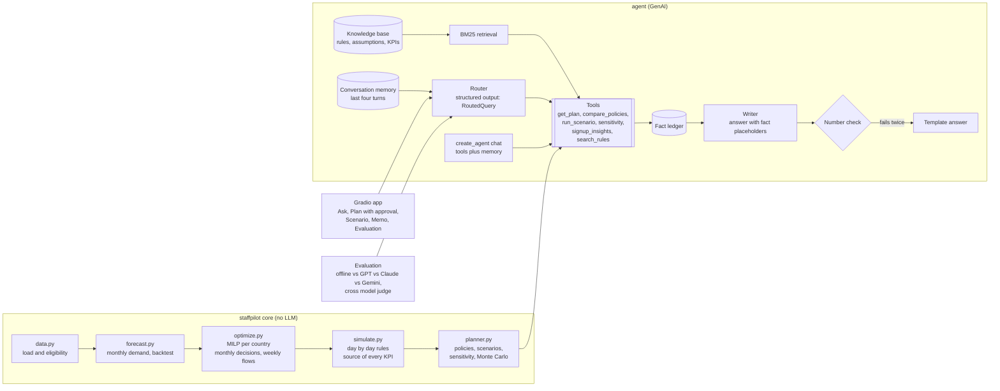

# StaffPilot

*Trio Intelligence* · built by **Seven Team-5374**

Monthly support agent staffing for 22 countries, with a GenAI planning assistant on top of the model.
IE5374 Applied Generative AI, Module 7 Hackathon, Topic 3: Dynamic Agent Staffing Optimization (a problem contributed by Google).

**Submission links:** GitHub repository `<add link>` · demo video (3 minutes) `<add link>` · notebook [`notebooks/StaffPilot_Topic3.ipynb`](notebooks/StaffPilot_Topic3.ipynb)

**Topic confirmation (R0):** `<date the team was confirmed for Topic 3 on the sign up sheet>`

## The short version

January headcount is about three times what demand needs. The recommended plan gives notice in January in 21 countries, hires a small number back before the fourth quarter peak, and grows Vietnam from 59 to 95 agents. It raises expected net value for the planning year from $370.4M to $479.7M (plus $109.3M, 30 percent), keeps about 2,200 agents on average instead of 6,474, and serves every eligible advertiser with an average wait of about a day. Uplift is the same under every policy; the whole gain is lower cost. Planned from the first year of data alone and scored on what actually happened in the second year, the method reaches 99.3 percent of the value of a plan made with hindsight.

StaffPilot lets a manager ask about this in plain English. A model reads each question into a typed request, the planner runs as a tool, and the answer is written with placeholders that are filled from tool output. Any number the tools did not produce, or that belongs to another country, is rejected before the answer is shown.

| Policy (all countries, planning year) | Net value | Uplift | Total cost | Service | Avg agents | Mean wait |
|---|---|---|---|---|---|---|
| Keep January headcount (hold) | $370.4M | $656.6M | $286.2M | 99.3% | 6,474 | 1.1 days |
| Match last month's demand (reactive) | $468.3M | $658.1M | $189.8M | 100.0% | 2,133 | 1.7 days |
| One cut to the yearly peak plus 10 percent | $464.1M | $658.1M | $194.0M | 100.0% | 2,978 | 0.0 days |
| Optimized for net value | $479.7M | $657.6M | $178.0M | 99.1% | 2,206 | 1.1 days |
| **Recommended: optimized, at least 98 percent served** | **$479.7M** | **$658.1M** | **$178.5M** | **100.0%** | **2,220** | **1.1 days** |

Numbers come from the day by day simulator, use the public copy of the data (2024 and 2025 sign ups, planning year 2026) and the assumptions below. Uplift is counted for advertisers who sign up in the planning year. The recommended plan pays $86.7M of one time firing cost. It differs from the pure value plan only in the UAE, where support does not pay for itself; keeping it there costs $0.03M.

## Architecture



## How the course techniques are used

The brief asks for at least two. All six are used, each inside the planning loop rather than beside it.

| Technique | Where | What it does |
|---|---|---|
| API calls | `agent/backends.py` | OpenAI, Anthropic and Google models through LangChain `init_chat_model` |
| Prompt engineering | `ROUTER_PROMPT`, `ANSWER_PROMPT`, `MEMO_PROMPT`, `JUDGE_PROMPT` | Role, intent definitions, multiplier conventions, the placeholder rule |
| Structured output | `agent/schemas.py`, `scenarios.py` | Pydantic `RoutedQuery`, `ScenarioParams`, `MemoDraft`, `Judgement`; native JSON schema mode |
| LangChain | `agent/tools.py`, `agent/chat_agent.py`, `agent/memory.py` | Six `StructuredTool`s; `create_agent` with an `InMemorySaver` checkpointer; conversation memory for the structured assistant |
| RAG | `agent/rag.py`, `knowledge/*.md` | BM25 over the case rules, assumptions and metric definitions, with citations |
| Agents | `agent/assistant.py`, `agent/chat_agent.py` | Two designs: a structured assistant that routes each question to one intent and runs that intent's tool (predictable and easy to evaluate), and a `create_agent` chat where the model chooses and chains tools itself; both pass the number check |

Two safeguards keep the GenAI part honest:

* **Charts with every answer.** Each planner tool draws a chart (headcount against need, policy comparison, scenario against plan, sensitivity, sign up patterns), so an answer shows the evidence as well as stating it.
* **Plain English.** Answers lead with the result and give the reason, the way an analyst talks to a manager, rather than echoing parameters.
* **Follow ups.** A chat remembers its last four turns (`agent/memory.py`). "And Mexico?" after a Brazil scenario reruns the same scenario for Mexico, and "What about 50 percent instead?" keeps the direction of the change. A language model router also receives the recent turns as context. Numbers repeated from an earlier answer are accepted only if that answer passed the number check.
* **Number check** (`agent/facts.py`). Models write `{{Germany.avg_active}}` instead of numbers. Placeholders are filled from tool output, and every number still in the text must match a tool fact within its printed precision. In a sentence that names a country, only that country's facts (or facts that belong to no country) count. A failing answer is retried once with feedback, then replaced by a deterministic template. Limits: signs are not read from the text, and small integers up to 12 (month numbers, counts) are not checked.
* **Offline backend.** A keyword router and template writer run the same pipeline without any API key. It keeps the notebook and tests reproducible and is the baseline the language models are measured against.

## Quick start

New to Python? Follow the step by step [setup guide](docs/SETUP_GUIDE.md) instead. To check everything works before a commit or a submission, follow the [testing guide](docs/TESTING_GUIDE.md).

Python 3.11, 3.12 or 3.13 (3.12 is what we use). Newer versions may lack prebuilt packages. Put the teaching team workbook in `data/raw/` (see [data/raw/README.md](data/raw/README.md)).

macOS or Linux:

```bash
python3.12 -m venv .venv
source .venv/bin/activate
pip install -e ".[dev,notebook]"
```

Windows (PowerShell). If activation is blocked by the execution policy, run the first line once per window:

```powershell
Set-ExecutionPolicy -Scope Process -ExecutionPolicy RemoteSigned
py -3.12 -m venv .venv
.venv\Scripts\Activate.ps1
pip install -e ".[dev,notebook]"
```

In `cmd.exe` use `.venv\Scripts\activate.bat` instead.

Then, on any system:

```bash
python -m staffpilot plan
python -m staffpilot eda
python -m staffpilot ask "What if sign ups in Brazil drop 30% in Q3?"
python -m staffpilot chat
python -m staffpilot chat --agent --backend anthropic_fast
python -m staffpilot memo Vietnam
python -m staffpilot app
python -m staffpilot history
python -m pytest
```

Add `--log-level INFO` (or `DEBUG`) before the command, or set `STAFFPILOT_LOG_LEVEL`, to see what the planner and the assistant are doing; every run also writes its own file in `logs/`.

`eda` writes a data quality and exploration report with six charts to `outputs/eda/`. `ask` and `memo` print a plain English answer and save a chart that illustrates it to `outputs/answers/`. `chat --agent` (with a key) switches to the LangChain `create_agent` chat, where the model chooses and chains the planner tools itself and every number is checked against the tool output; a recorded live run is in [docs/AGENT_LIVE_CHECK.md](docs/AGENT_LIVE_CHECK.md). `chat` is the same assistant in a conversation: follow ups use the earlier questions, `new` starts over, `save` writes the conversation to `outputs/conversations/chat.md`, and an empty line quits. `plan` prints the alerts that need attention and writes `outputs/plan.csv` (the recommended plan: 22 countries by 12 months with hires, notices, agents in ramp up and in notice, and payroll), `outputs/kpis.csv` and `outputs/policy_comparison.csv`. `app` starts the Gradio interface at http://127.0.0.1:7860.

To rebuild and execute the notebook: `python scripts/build_notebook.py`. The build is offline even when API keys are set, so it never costs money; the evaluation section reads `eval/results/` instead of calling models. `--live` lets the demo cells call the models, after you type yes.

### Using language models

Set any of `OPENAI_API_KEY`, `ANTHROPIC_API_KEY`, `GOOGLE_API_KEY`, either in the shell or in a `.env` file at the repository root (copy `.env.example`; it is never committed).

No model name is written in the code. For each provider with a key, `agent/catalog.py` asks the provider's model list endpoint which chat models the key can use (a free request that sends no tokens), drops speech, image and embedding models, and sorts the rest from cheapest to most expensive: by `[llm.prices]` in the config when a model is listed there, otherwise by its family name (nano, lite, then mini, haiku and flash, then the standard models, then sonnet, pro and opus). The fast tier takes the cheapest, the strong tier the most capable stable model (OpenAI's premium "pro" models are never picked on their own). At equal price a model without built in reasoning comes first, because it answers in seconds rather than tens of seconds, and dated copies such as `gpt-5-nano-2025-08-07` are hidden when the plain name is listed.

A listed model is not always usable: providers keep retired models in their lists and answer 404 when called (on this account `gpt-4.1-nano` is listed but retired). On start the app therefore sends one tiny request to the cheapest models until one answers (`catalog.working_default`, a few tokens, remembered for a day in `.cache/model_checks.json`), hides any that failed and marks the cheapest working one in the list. The selection itself always starts on Offline, so nothing else reaches a model until someone picks one. `python -m staffpilot models --ping` checks the two tiers from the command line. Reasoning models are called with low reasoning effort, which cut a `gpt-5-nano` request from about 25 seconds to about 3. To pin a model, for example to keep an evaluation repeatable, set it under `[llm.models]` or `[llm.fast_models]` in `config/staffpilot.toml`.

```bash
python -m staffpilot models
python -m staffpilot models --ping
python -m staffpilot ask "How many agents does Germany need in March and why?" --backend anthropic_fast
python -m staffpilot eval
```

`models` lists what each provider offers, cheapest first, and marks the models the two tiers use; `--ping` also sends one tiny request to those models and prints `ok` or the reason it failed. `--backend` takes `offline`, a provider (`anthropic`, or `anthropic_fast` for the cheap tier) or a full `provider:model` name from that list. When a model fails during use, the log names the error and its message, and the assistant falls back to the offline router or the template answer.

`eval` runs every provider with a key at both tiers (`--tier strong`, `fast` or `both`) and the `create_agent` chat (`--skip-agent` to leave it out). It is the only command that makes many paid calls. Replies and their token counts are cached in `eval/cache/`, so reruns cost nothing; commit that folder so the notebook shows the same results. To stay offline while keys are set, set `STAFFPILOT_OFFLINE=1`.

### How the offline mode answers

Without a key (or with `STAFFPILOT_OFFLINE=1`) the assistant still answers, with no model at all:

1. **Reading the question.** A keyword router (`OfflineBackend.route`) picks the intent from word lists checked in a fixed order (memo, sensitivity, what if, compare, insight, rules, plan), finds country names and aliases ("the US"), months and quarters, and for a what if reads the change: a percent with its direction ("drop 30%" is a multiplier of 0.7), a threshold, salary, capacity, hiring cap, queue order or service target.
2. **Running the planner.** The same tools a language model would call run the same optimizer and simulator, so the numbers are exactly those of the model.
3. **Writing the answer.** Templates written like an analyst talking to a manager fill in the tool facts through `{{placeholders}}`, so every number is checked like any other answer.
4. **Rules questions** use the same BM25 retrieval over the knowledge base, with citations.

It is free, fast and deterministic, which is why the tests, CI and the notebook use it. Its limit is phrasing: it understands the wording of the main test set (100 percent intent accuracy) far better than new wording (28 percent on the holdout), which is the gap a language model router closes.

### Switching to the official IE5374 file

Change one line in `config/staffpilot.toml`:

```toml
[data]
path = "data/raw/<official file>.xlsx"
```

No year appears in the code. The planning year is one year after the last sign up year, so the IE5374 copy (2023 and 2024) plans 2025. `tests/test_dataset_swap.py` shifts all dates by a year and checks that the plan stays the same apart from small differences from week boundaries and leap years (on the real data, net value moves by 0.02 percent). The public copy contains 920 rows dated 29 February 2025, a day that does not exist; they are moved to 28 February.

## The app

`python -m staffpilot app` opens a planning desk in the browser: a cool grey canvas with white working panels, one deep teal accent and IBM Plex Sans with figures that line up in columns, in light and dark mode (add `?__theme=dark` to the address), on desktop and phone.

* **Sidebar**: New chat, the pages, the recent chats of this browser tab (click one to reopen it with its memory) and Settings: the language model list (Offline, which is the default and free, then every model your keys can use, cheapest first, with retired models removed and the cheapest working one marked), Refresh models and Save conversation. On a phone the sidebar opens from the top left and closes after a choice. Every item explains itself on hover.
* **Assistant**: plain English chat with follow up questions. The chart sits inside the answer; the panel beside it shows how the answer was built (number check, intent, time, tool and model, what a follow up kept), the tool output and how the question was read.
* **Plan**: the headline numbers live here only, as five cards (net value, agents at work, advertisers served, agent utilization, total cost). Each has a line of the twelve months, the change against keeping the January team all year, and a tooltip that defines the number. Below them sit the alerts, the headcount chart and the month by month table, for all countries or one, with an approval step.
* **Scenario**, **Memo**, **Data** and **Evaluation** as before; the Data and Evaluation pages load the first time they are opened.

The look lives in `src/staffpilot/ui/` (`theme.py` for Gradio's components, `style.css` for the rest, `components.py` for the shared pieces, `icon.py` for the mark) and the charts use the same colours (`charts.py`); `app.py` holds the layout and the handlers. The browser tab icon is drawn from the same staffing curve as the sidebar mark, so the two always match.

## Start up time

The first start reads the 500,000 row workbook and solves 22 optimization models per policy, which took about 17 seconds. Two things make later starts fast:

* **A disk cache** (`.cache/`, not committed) keeps the workbook's sheets until the file changes and the solved base plans, keyed by the data, the settings and the planning code, so a change to any of them starts fresh. A warm start of the planner takes under a second; the app is ready in about 4 seconds, most of it importing Gradio. `STAFFPILOT_NO_CACHE=1` turns it off, and deleting `.cache/` resets it.
* **Parallel solving**: countries are independent models solved by separate CBC processes, so they run side by side. A cold start now takes about 12 seconds.

Model lists from the three providers are also requested at the same time, and the Data and Evaluation pages are filled only when they are opened.

## Logging, run history and alerts

* **Logging by level.** Every module logs through Python's `logging` (`staffpilot.logs`). The terminal shows WARNING by default; INFO shows each run and answer, DEBUG adds solver times and token counts.
* **One log file per run.** Every command, app start and notebook run writes its own file named after the start time and the command, for example `logs/20261102_232446_plan.log`. The first lines record the command, the StaffPilot and Python versions and the data file; the file always keeps INFO even when the terminal shows warnings only. The newest 50 files are kept, and `STAFFPILOT_LOG_DIR` moves the folder (the tests use a temporary one).
* **Run history.** Each `plan` run appends a line to `runs/runs.jsonl` with the dataset file and its fingerprint, the settings hash, the git commit, the key results and the alert count. `python -m staffpilot history` lists them, so any number in the report can be traced to the data and settings that produced it.
* **Alerts.** `staffpilot.alerts` turns the plan into plain warnings a manager should see before acting: the data plans a different year than the brief, service below 98 percent, the ten advertiser limit broken, long waits, a country that must hire, deep cuts that need HR and legal checks, a country where support does not pay, and the open question about how uplift is counted. They show in the CLI, the app header and the notebook.

### Why not Airflow, Kibana or an alerting service

| Tool | Would it help here? | Decision |
|---|---|---|
| Experiment tracking (MLflow, Weights and Biases) | We have no model training; runs are deterministic and fast | A JSON lines run history gives traceability without a server |
| LLM tracing (LangSmith, Langfuse) | Useful once the assistant has real users | Token counts and latency are logged and kept in the evaluation; LangSmith can be switched on with its environment variables |
| Airflow or another scheduler | The plan should be refreshed monthly when new sign ups arrive | Not for a one week project: a grader cannot run it and one monthly job does not need a scheduler. In production, the monthly refresh (load data, plan, alerts, memos) is the natural first DAG |
| Kibana or Grafana | Search over logs of a running service | No running service here; the log file and the app cover it. Ship the same logs to Elasticsearch only when the app serves real users |
| Stored chat history (a database or vector memory) | Only if managers come back to old conversations | Short term memory per chat is enough for one planning session. Storing chats would make answers depend on old, possibly stale numbers, make the evaluation harder to repeat and raise privacy questions; chats are saved only when the user asks |
| Paging or email alerts | Someone must act on a critical finding | Alerts are shown where decisions are made (CLI, app, notebook). Sending them would need a production owner and is out of scope |

## Method

* **Forecast.** Monthly eligible sign ups per country. Three seasonal methods are backtested on the last history year; with one training year they tie, so the seasonal mean of both years is used.
* **Optimizer.** One mixed integer program per country (PuLP with CBC). Hires and notices are monthly; advertiser flows are weekly, with a nine week slot occupancy and an eight week wait limit. Three months of lookahead stop the model from cutting staff in December only because the horizon ends. A penalty of 1 percent of uplift per week waited makes it prefer earlier service.
* **Simulator.** Applies the brief rules day by day: graduation after 60 days, removal after 60 days of waiting, at most 10 advertisers per agent, ramp up and notice. A slot counts as free only if it exists for the whole support period, so agents under notice take no new advertisers. All reported numbers come from here.
* **What we got wrong first.** Our first simulator filled today's free slots greedily, and every plan that cut headcount then broke the ten advertiser limit. We blamed the optimizer's monthly flows and rebuilt them weekly, but the real fix was the dispatch rule above. With it, a simpler monthly flow model is also feasible and earns $1.4M more, but advertisers wait almost twice as long (2.0 versus 1.1 days); `Planner.flow_resolution_check` and notebook section 5 show both. We keep weekly flows for timely support.

## Assumptions

The brief leaves some points open. Each is a switch in the config; the notebook measures the ones that matter.

| | Assumption | Effect when changed |
|---|---|---|
| A1 | Uplift applies to the projected annual budget, once, for the sign up cohort | Counting only the 60 day window: every policy loses money (hold $-178.3M, optimized $-67.0M); the plan still beats hold by $111M and gives even more notices |
| A2 | Eligible means budget strictly greater than the threshold | 13 sign ups sit on a threshold |
| A3 | The pool is empty on 1 January | If the last 60 days of history were waiting: 21,543 extra advertisers, net value $606.3M, 2,576 agents on average |
| A4 | Agents in ramp up are paid | |
| A5 | Agents under notice work and are paid; the 40 percent cost is charged in the notice month | |
| A6 | Capacity is pooled per country | |
| A7 | First decisions in January take effect in February | Matters for Vietnam |
| A8 | First in, first out pool | Highest budget first: $478.7M, shorter waits, small advertisers wait longer |
| A9 | Waiting does not reduce uplift within 60 days; the optimizer prefers early service | Without that preference: $482.8M but the mean wait rises from 1.1 to 3.0 days |
| A10 | No hiring cap | Testable as a scenario |
| A11 | Three months of lookahead | |

Full text in [src/staffpilot/knowledge/assumptions.md](src/staffpilot/knowledge/assumptions.md). A1, A3, A4 and A5 should be confirmed on the course forum before submission.

## Evaluation of the assistant

`eval/testset.jsonl` has 40 labelled questions across eight intents (plan lookup, compare, what if, sensitivity, insight, memo, rules, out of scope). `eval/holdout.jsonl` has 32 more written in different words. `eval/followups.jsonl` has 10 follow ups, each asked after the earlier question it lists in `context`. For each backend and split the harness reports:

* intent, country and scenario field accuracy of the structured request;
* grounded rate (passes the number check without the template fallback; always 100 percent for the offline templates, by construction);
* a 1 to 5 judge score, averaged over judge models from every other provider, with a written rubric (no model grades its own provider);
* tool choice accuracy of the `create_agent` chat;
* tokens, cost (where a price is configured) and latency.

Strong and fast tiers are compared separately so each model faces its peers. Retrieval is scored on its own: for rule questions labelled with the passage that answers them, BM25 puts that passage in the top three for 6 of 7.

| Split | Backend | Intent accuracy | Country accuracy | Scenario accuracy | Grounded |
|---|---|---|---|---|---|
| main (40) | offline | 100% | 100% | 100% | 100% |
| holdout (32) | offline | 28% | 81% | 0% | 100% |
| followups (10) | offline | 90% | 100% | 75% | 100% |

The offline keywords were written while looking at the main set, so its main score flatters it; the holdout shows the gap a language model router has to close. The follow up rules were written together with the follow up set, so treat that row as a regression check; the one miss ("What would that look like for Italy?") is a follow up without a clear cue, which is where a router that reads the history should do better. **The language model rows need API keys:** run `python -m staffpilot eval` with at least two providers set, then rebuild the notebook. The results also write `eval/results/routing.json`, which recommends a model per intent from the holdout when an intent has at least three questions; the app does not apply it on its own, the user picks the model in Settings.

## Requirement trace

| ID | Requirement | Evidence |
|---|---|---|
| R1, R2 | Agents per country per month, with hiring and notice dates | `outputs/plan.csv`, notebook section 8 |
| R3 to R11 | Brief rules | `simulate.py`, `optimize.py`, `tests/test_simulate.py`, `tests/test_optimize.py` |
| R12 | Cost, timely support, scalability | KPI table and policy comparison, notebook sections 7 to 9 |
| R13 | Analysis and justification | [docs/report.md](docs/report.md) |
| R14 | Sign up volume sensitivity | notebook section 10, Monte Carlo |
| R15 | Other considerations | notebook section 13, report |
| R16 | Dataset, easy swap | `config/staffpilot.toml`, `tests/test_dataset_swap.py` |
| R17 to R22 | GenAI app with at least two techniques, assistant, insights, scenario explorer, memo | table above, notebook section 14, `app.py` |
| R26 | Executed notebook | `notebooks/StaffPilot_Topic3.ipynb` |
| R27 | README with setup, diagram, contributions | this file |
| R29 | AI use disclosed and marked | [docs/AI_USAGE.md](docs/AI_USAGE.md), a marker under every notebook section |
| R30 | Checked against the rubric | self assessment below |

## Self assessment against the reference rubric

| Criterion (points) | Evidence | Status |
|---|---|---|
| Problem statement and vision (15) | Headline finding, open points of the brief turned into measured assumptions | done |
| LangChain agent design (20) | Six tools, structured outputs, conversation memory with follow ups, `create_agent` with memory, number check with retry, offline fallback | done; the `create_agent` chat was checked live with `claude-haiku-5-5` ([docs/AGENT_LIVE_CHECK.md](docs/AGENT_LIVE_CHECK.md)) |
| Multi LLM evaluation (20) | 82 labelled questions (10 of them follow ups), judge panel, tiers, tokens, routing table | harness done; **LLM rows need a run with keys** |
| Data use (15) | Real budgets per advertiser, backtest on real sign ups, leap day repair, threshold scenarios | done; rerun on the official IE5374 file |
| Presentation and demo (20) | Executed notebook, Gradio app with plan approval, report | **video still to record** |
| Innovation (10) | Fact placeholders with attribution check, routing table from the evaluation, plan approval step | done |

## Repository layout

```
config/staffpilot.toml      project settings (dataset path)
data/raw/                   put the teaching team file here (not committed)
docs/                       setup guide, testing guide, live agent check, report, AI usage
eval/                       test sets, cached model replies, results
notebooks/                  executed submission notebook
outputs/                    plan, KPIs, policy comparison
scripts/                    notebook builder, writing style check
src/staffpilot/             package (core model, agent, app, CLI); ui/ holds the app's theme and styles
tests/                      105 tests on synthetic data with years 2031 and 2032
```

## Tests and CI

`python -m pytest` runs 105 tests in about 20 seconds on synthetic data, so no dataset or API key is needed. They include a syntax and import check of every module, logging levels, the EDA report, the charts, alerts, the run history, the command line end to end (including the chat command), every app handler, conversation memory and follow ups, and they cover every brief rule on cases small enough to check by hand, the dataset swap, the number check and its country attribution, offline routing, unknown countries, out of range scenarios, model failure fallback and the evaluation harness. GitHub Actions runs a syntax check (`compileall`), lint, the writing style check, the tests and the command line tools on a synthetic workbook, on Ubuntu, macOS and Windows with Python 3.11, 3.12 and 3.13 (`.github/workflows/ci.yml`).

## Team contributions

Seven Team-5374, *Trio Intelligence*. Each member worked where their background is strongest; all three reviewed the plan, the assumptions and the final report.

| Member | Role | Main contributions |
|---|---|---|
| **Quoc Hung Le (Kevin)** | Team lead, solution architect and lead engineer | Chose Topic 3 and set the strategy against the brief and rubric. Designed the architecture and built most of the code: data loading with the date repair and caching, the forecast and backtest, the planning pipeline end to end, the GenAI assistant (structured routing, planner tools, BM25 retrieval, the fact placeholder number check, conversation memory, model discovery), the Gradio app and its design, the evaluation harness, logging, alerts, CI on three systems and the executed notebook. Kept the repository, documentation and submission together. Background: data analytics and BI at Viettel and Samsung (ETL, workforce dashboards, forecasting). |
| **Hamad Al Sulaimi** | Optimization and process analysis | Reviewed the planning model against the brief's rules (capacity, waiting pool, ramp up, notice), helped shape the assumptions A1 to A11 and their sensitivity tests, defined the KPIs shown on the Plan page, and wrote the process improvement view in the report. Background: Industrial Engineering, Lean process improvement and Power BI. |
| **Khoa Tran** | Operations and business validation | Checked the plan against real capacity planning practice, designed the what if scenarios and the labelled test questions, interpreted the sensitivity and Monte Carlo results, ran the testing guide before submission, and led the business recommendations and the demo video. Background: supply chain and transportation operations, capacity planning and fleet utilization. |

## AI use

AI assistants were used to draft the code, tests and documentation. Every result in this README was produced by running the code, and the team reviewed and tested all AI assisted parts. Each notebook section carries a marker; details in [docs/AI_USAGE.md](docs/AI_USAGE.md).

## References

* OptiGuide, LLMs for supply chain what if analysis on top of a solver: https://arxiv.org/abs/2307.03875
* OptiChat, query types for LLM assistants over optimization models: https://arxiv.org/abs/2501.08406
* SymGen, symbolic references to keep generated numbers traceable: https://arxiv.org/abs/2311.09188
* Zheng et al., judging LLMs with LLMs: https://arxiv.org/abs/2306.05685
* Gans and Zhou (2002), managing learning and turnover in employee staffing: https://faculty.washington.edu/yongpin/Staffing_OR.pdf
* Green, Kolesar and Whitt (2007), staffing with time varying demand: https://www.columbia.edu/~ww2040/TimeVarying1217.pdf
* LangChain 1.x agents: https://docs.langchain.com/oss/python/releases/v1

## License

MIT. Copyright © 2026 Seven Team-5374. *Trio Intelligence.*
