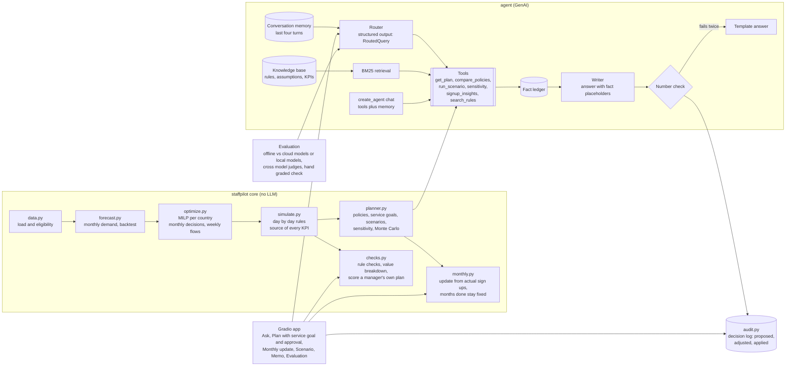

# Methods and design

The details behind the [README](../README.md): how each block works, why it was chosen, and the numbers behind every claim. Every figure comes from the code on the IE5374 workbook from Canvas (planning year 2026).

Sections: architecture, method, what the manager decides, assumptions, how the course techniques are used, the app, which page for which moment, start up time, and logging, run history and alerts.

## Architecture



### How the blocks work together

**Planning core, from the file to a plan.** No language model is involved, and the same inputs always give the same plan.

1. **Load** (`data.py`). Reads the workbook, or a folder of three CSV files, and matches columns by name, so a new file loads without a code change. Impossible dates such as 2025-02-29 are moved to the last day of their month (920 rows) and reported. A sign up is eligible when its budget is above its country's threshold. The planning year is the year after the last year in the data.
2. **Forecast** (`forecast.py`). Counts eligible sign ups per country and month and backtests three seasonal methods on the last history year: **last year** (each month repeats the same month of the last year), **seasonal mean** (the average of that month over the history years) and **seasonal trend** (the seasonal mean scaled by the growth between the last two years). The most accurate one, preferring the simpler methods when the errors are within half a percentage point, forecasts the planning year plus three lookahead months, with the mean budget of each month.
3. **Optimize** (`optimize.py`). One integer program per country, solved by CBC. Hires and notices are decided per month and advertiser flows are tracked per week; the objective is uplift minus salary and firing cost. The lookahead months stop the model from cutting everyone in December only because the horizon ends there.
4. **Simulate** (`simulate.py`). Replays the plan day by day under the brief rules: ten advertisers per agent, 60 days of support, 60 days in the pool, ramp up and notice. Every reported number comes from this step.
5. **Repair** (`planner.py`). When the simulator finds a day with more advertisers than free slots, or service below the target, the planner raises the minimum headcount for that month and the next and solves again, for up to six rounds.
6. **Compare and test** (`planner.py`, `scenarios.py`). The same pipeline produces the baselines (hold, reactive, peak cover), the service goals from profit only to 98 percent within 7 days, the what if scenarios (stress the current plan, or rebuild it), the sensitivity table and the Monte Carlo runs. Countries are solved in parallel and base plans are cached on disk.
7. **Update during the year** (`monthly.py`). With the actual sign ups so far, the months already done keep their decisions and only the remaining months are solved again.
8. **Log the decision** (`audit.py`). Approving a plan or an update, running a scenario and answering a question each add rows to the decision log.

**Assistant, from a question to a checked answer.**

1. **Route.** A language model turns the question into a typed `RoutedQuery` (intent, countries, months, scenario changes) through structured output. A reply that misses the schema is repaired field by field. Without a key, the keyword router fills the same object.
2. **Clean and remember.** Names are matched to the data ("the US" is USA, "Indian" is India), a change outside the allowed range gets a clear message, and a follow up such as "And Mexico?" takes what it leaves out from the previous turn.
3. **Run tools.** The intent decides which planner tool runs. Each tool returns a table, a chart, notes and a list of named facts such as `Brazil.hires`, which go into the fact ledger.
4. **Write.** The writer model sees the fact names with their values and writes `{{Brazil.hires}}` where a number belongs.
5. **Check.** The ledger fills the placeholders. The draft is rejected if a placeholder is unknown, a fact name or JSON is left in the text, or a number does not match a fact within its printed precision or belongs to another country. A rejected draft is retried once with the reason, and a second failure is replaced by the template answer built from the same facts.
6. **Show.** The app shows the answer, its chart, and a panel with the number check, the intent, the tools, the model and the time taken.

### What is special about this design

* **The language model never produces a number.** It decides what to run and how to say the result. Every figure comes from the planner through a placeholder, and each answer is checked before it is shown.
* **An independent simulator checks the optimizer.** The program plans with weekly flows to stay fast; the simulator applies the exact daily rules and sends the plan back when it breaks one. The KPIs are the simulator's, so a simplification inside the program cannot leak into a reported number.
* **Every failure has a safe fallback.** A model that is down, slow or returns bad JSON falls back to the offline router or the template answer, so the user always gets a checked answer and never a stack trace.
* **One planner behind every page.** The plan, the comparison with baselines, the scenarios, the sensitivity and the memo all call the same code, so their numbers agree.
* **Open questions are settings.** How uplift is counted, who waits in the pool on 1 January, the queue order, pay during ramp up and the eligibility rule are switches in `config/staffpilot.toml`, so the other reading takes one change to test. The section on assumptions reports how much each one moves the result.
* **The manager decides.** The Plan page offers the service goal and an approval step, the Monthly update page corrects the plan with actual numbers, and the Scenario page shows the parameters it read so they can be corrected before the run.
* **The manager can check the plan.** Every rule is tested with its numbers, net value is rebuilt from its inputs, and any headcount the manager types is scored by the same simulator.
* **Nothing is a black box.** The decision log keeps apart what the optimizer or a language model proposed, what the simulator check, a guardrail or the manager changed, and what was applied.
* **Sized for the decision it supports.** A few managers plan once a month, so the design puts correct, traceable answers ahead of heavy traffic. A cold start solves the 22 countries in about 12 seconds and a warm start reads the cache. Serving many users at once would need a shared cache and a queue for solver runs; the model itself would not change.

## Method

* **Forecast.** Monthly eligible sign ups per country. Three seasonal methods are backtested on the last history year; with one training year they tie, so the seasonal mean of both years is used.
* **Optimizer.** One mixed integer program per country (PuLP with CBC). Hires and notices are monthly; advertiser flows are weekly, with a nine week slot occupancy and an eight week wait limit. Three months of lookahead stop the model from cutting staff in December only because the horizon ends. A penalty of 1 percent of uplift per week waited makes it prefer earlier service.
* **Simulator.** Applies the brief rules day by day: graduation after 60 days, removal after 60 days of waiting, at most 10 advertisers per agent, ramp up and notice. A slot counts as free only if it exists for the whole support period, so agents under notice take no new advertisers. All reported numbers come from here.
* **What we got wrong first.** Our first simulator filled today's free slots greedily, and every plan that cut headcount then broke the ten advertiser limit. We blamed the optimizer's monthly flows and rebuilt them weekly, but the real fix was the dispatch rule above. With it, a simpler monthly flow model is also feasible and earns $1.4M more, but advertisers wait almost twice as long (2.0 versus 1.1 days); `Planner.flow_resolution_check` and notebook section 5 show both. We keep weekly flows for timely support.

## What the manager decides

The model proposes; three choices stay with the manager, and each has its own place in the app.

### Profit only, or profit with a service level

The Plan page has a **Service goal** list. Profit only maximizes net value. The other goals add a service level agreement (SLA): at least 98 percent of eligible advertisers served, optionally within a time limit. Each goal is its own optimization, scored by the same simulator (`Planner.service_tradeoff`, `outputs/service_tradeoff.csv`).

| Service goal | Net value | Given up against profit only | Served | Served within 7 days | Avg agents | Mean wait |
|---|---|---|---|---|---|---|
| Profit only | $479.7M | | 99.1% | 91.4% | 2,206 | 1.1 days |
| **At least 98% served (recommended)** | **$479.7M** | **$0.03M** | **100.0%** | **92.1%** | **2,220** | **1.1 days** |
| At least 98% served within 21 days | $479.4M | $0.24M | 100.0% | 93.1% | 2,223 | 1.0 days |
| At least 98% served within 14 days | $479.1M | $0.58M | 100.0% | 95.1% | 2,225 | 0.9 days |
| At least 98% served within 7 days | $476.1M | $3.61M | 100.0% | 100.0% | 2,307 | 0.1 days |

Serving everyone is almost free, because support pays for itself in 21 of 22 countries; the $0.03M is the UAE, where it does not. Speed is where the real choice lies: answering every advertiser within a week costs $3.6M (0.75 percent of net value) and about 87 more agents than the recommended plan. We recommend the 98 percent goal and show the faster ones as an option, since the brief values timely support but puts no price on a day of waiting.

How it works: the goal is a soft constraint in the integer program. Only advertisers served within the limit count towards it, later service is still allowed as the brief's 60 day window allows, and missing the goal costs more per advertiser than a year of an agent's salary. The model therefore hires whenever hiring can meet the goal, and a goal that lead times make impossible (hires start a month late) is met as far as possible instead of leaving no plan.

### Can the manager trust the numbers?

The Plan page has three tabs besides the overview, so a manager can check the plan instead of taking it on trust.

* **Check the plan** tests it against every rule of the brief and against its rivals, each with the numbers: no agent above 10 advertisers on any day, nobody served after 60 days in the pool, hires and notices that respect ramp up and notice, costs that follow the brief, the service goal, the solver's proof of optimality (CBC, 22 of 22 countries), the gain over every simple rule ($109.3M over keeping the January team, $11.3M over the best heuristic) and the backtest (99.3 percent of hindsight value). For all countries, 8 of 8 checks pass.
* **How it is calculated** rebuilds net value from its inputs: 106,182 advertisers served times a $45,911 average budget times 13.5 percent expected uplift = $658.1M, minus 26,992 paid agent months of salary ($91.7M) and 4,741 notices at 40 percent of salary ($86.7M), equals $479.7M, the number on the card. Below it, the simulator's month by month table (sign ups, served, waiting, agents, slots, utilization, cost) can be downloaded as a CSV.
* **Try your own plan** lets the manager type the agents for each month of a country and scores that plan with the same simulator, next to the optimized one. More agents always earn less.

The same check also says where the plan is not the cheapest possible. Scored day by day, a plan with 5 percent fewer agents from February still keeps every rule and earns $1.8M more (0.4 percent), but the average wait goes from 1.1 to 2.1 days. The model plans advertiser flows week by week and prefers early service (assumption A9), so it keeps that margin. The app shows this as a note rather than hiding it, because whether a day of waiting is worth the money is the manager's call.

### A monthly update when sign ups differ from the forecast

A plan is a forecast, and the forecast will be wrong. The **Monthly update** page (and `python -m staffpilot update`) plans the rest of the year again. The manager picks the month, enters the actual eligible sign ups of the months before it and how many agents are really on staff that month (the box is filled with the plan's count, so after two resignations the manager types two fewer). Then `Planner.monthly_update`:

1. keeps the hires and notices already carried out, because they cannot be undone,
2. uses the actual counts for the months done and scales the forecast of the remaining months by how far the last three months were from it,
3. solves only the remaining months again, with the same optimizer and simulator check, and
4. compares the updated plan with keeping the approved plan on the new numbers.

| Example | Keep the approved plan | Updated plan | Decide this month |
|---|---|---|---|
| Germany, February, January sign ups 40% above forecast | 87.7% served, 32.4 day wait, $33.7M | 100.0% served, 1.8 day wait, $39.2M (+$5.5M) | hire 31 (plan: 0) |
| USA, March, sign ups 20% above forecast | 100.0% served, 12.8 day wait, $147.2M | 100.0% served, 2.3 day wait, $144.3M | hire 39 (plan: 0) to bring the wait back down |
| Vietnam, May, sign ups 20% below forecast, 2 agents resigned | 100.0% served, $7.7M | 100.0% served, $7.8M | September hiring cut from 18 to 1 |

The answer is the size of the correction, up or down: the plan said hire none in March, the update says hire 39.

### A decision log that keeps GenAI apart from the model

Every approval and run in the app adds rows to `outputs/decision_audit.csv`, shown on the **Decision log** page. Each row names the signed in **user** who took the decision and keeps three things apart:

* **proposed**: the first value and who produced it (the optimizer, the forecast, or a language model that read the manager's words),
* **adjusted**: a later change and who made it (the simulator check, a monthly update, a GenAI guardrail or the manager),
* **applied**: the value that was used.

| Decision | What the rows show |
|---|---|
| Plan approved | the service goal (recommended or changed by the manager), each hire and notice, and every month where the simulator check raised the optimizer's first headcount |
| Monthly update approved | forecast against the actual sign ups the manager entered, the headcount change, and every month whose agents, hires or notices moved |
| Scenario run | each parameter as the language model read it from the sentence, as the manager edited it and as it was run, then the results marked as computed by the planner |
| Assistant answer | the model that routed and wrote it, and the guardrails that acted: a router reply repaired field by field, names that are not countries dropped, a draft rejected by the number check, the template answer used instead |

A language model touches numbers in two places only: it reads a sentence into scenario parameters, and it writes answers with placeholders. The log shows both, so a reader can see that every staffing number came from the planner.

## Assumptions

The brief leaves some points open, and the teaching assistant confirmed that each team may set its own assumptions and numbers as long as it explains them logically. We followed two rules when choosing. Where the brief's words point one way, we take the literal reading. Where they do not, we take the reading that makes our result look worse rather than better, so the headline number is not inflated by a convenient choice. Every assumption is a switch in `config/staffpilot.toml` or a scenario, and the notebook (section 11) measures the ones that move the result.

| | Assumption | Why | Effect when changed |
|---|---|---|---|
| A1 | Uplift applies to the projected annual budget, once, for the sign up cohort | The budget in the data is annual, and setup work done during support keeps paying after it ends | 60 day window only: every policy loses money (minus $178.3M if January headcount is kept, minus $67.0M optimized), yet the optimized plan still wins by $111M |
| A2 | Eligible means budget strictly greater than the threshold | The brief says "exceeds" | 13 sign ups sit exactly on a threshold |
| A3 | The pool is empty on 1 January | The brief says agents start the year with no advertisers, and the history does not say who was waiting | Last 60 days still waiting: 21,543 more advertisers, $606.3M, 2,576 agents on average instead of 2,206 |
| A4 | Agents in ramp up are paid | They are employees in training | Unpaid: $1.2M more value and 428 hires instead of 353 |
| A5 | Agents under notice are paid for the notice month and keep serving the advertisers they hold, but take no new ones; the 40 percent cost is charged in the notice month | That is what a notice period means, and it keeps every advertiser's 60 days intact | Every notice falls in January, so the month the cost is charged does not change the year's $87.1M; an unpaid notice month would save at most $18.2M |
| A6 | Capacity is pooled per country | Any agent in a country can take the next advertiser | |
| A7 | First decisions in January take effect in February | A decision needs a month of notice or ramp up | Matters for Vietnam |
| A8 | First in, first out pool | The fairest order: whoever signed up first is served first | Highest budget first: $478.7M, shorter waits, small advertisers wait longer |
| A9 | Waiting does not reduce uplift within 60 days; the optimizer still prefers early service | The brief asks for timely support | Without that preference: $482.8M but the mean wait rises from 1.1 to 3.0 days |
| A10 | No hiring cap | The brief sets none | Testable as a scenario |
| A11 | Three months of lookahead | Stops the model from cutting staff in December only because the horizon ends | |

### Why these choices hold up

**A1 is the assumption that decides whether support pays at all, so we state it plainly: if uplift lasts only during the 60 days of support, the support program loses money under every staffing policy.** We still count uplift on the annual budget for three reasons.

* The data gives each advertiser a projected annual budget, and the brief states the uplift as a share of ad spend without naming a shorter period. The annual budget is the only base the data offers.
* Support is onboarding: an agent helps set up accounts, campaign structure and bidding. Those campaigns keep running after the agent moves on, so the extra spend does not stop on day 61. An advertiser with a $120,000 budget who spends 13.5 percent more gives about $16,200 of uplift; counting only 60 days would give about $2,700.
* Uplift is counted once, in the advertiser's sign up cohort, so a supported advertiser is never counted twice across years.

More important for the staffing question, the decision does not depend on A1. Under both readings every notice is given in January (4,756 with annual uplift, 4,962 with the window), and the plan beats keeping January headcount by about $109M to $111M. A1 changes how much the program is worth, not how many agents to have.

**A3** is the literal reading of the brief. The carryover alternative needs a guess about who was still waiting on 31 December, which the data does not record. It is also the conservative choice: with the carryover the plan is worth $606.3M instead of $479.7M, so starting empty lowers our headline rather than raising it.

**A4** follows normal employment: a new hire is paid while training. It is again the conservative choice, since an unpaid ramp up would add $1.2M and let the model hire more freely (428 hires instead of 353).

**A5** is what a notice period is for. An agent under notice is still employed for that month and is paid, and finishes the advertisers already assigned, so nobody loses support halfway through. The simulator gives such agents no new advertisers, which is how the plan avoids breaking the ten advertiser limit when headcount falls. Charging the 40 percent cost in the notice month is the simpler bookkeeping, and here it changes nothing: every notice in the plan is given in January, so the year's firing cost is $87.1M either way. The alternative of letting agents go at once without pay would save at most $18.2M, under 4 percent of net value, and would empty the notice rule of meaning.

Full text in [src/staffpilot/knowledge/assumptions.md](../src/staffpilot/knowledge/assumptions.md); the assistant cites it when asked about an assumption.

## How the course techniques are used

The brief asks for at least two. All six are used, each inside the planning loop rather than beside it.

| Technique | Where | What it does |
|---|---|---|
| API calls | `agent/backends.py` | OpenAI, Anthropic and Google models through LangChain `init_chat_model` |
| Prompt engineering | `ROUTER_PROMPT`, `ANSWER_PROMPT`, `MEMO_PROMPT`, `JUDGE_PROMPT` | Role, intent definitions, multiplier conventions, the placeholder rule |
| Structured output | `agent/schemas.py`, `scenarios.py` | Pydantic `RoutedQuery`, `ScenarioParams`, `MemoDraft`, `Judgement`; native JSON schema mode |
| LangChain | `agent/tools.py`, `agent/chat_agent.py`, `agent/memory.py` | Six `StructuredTool`s; `create_agent` with an `InMemorySaver` checkpointer; conversation memory for the structured assistant |
| RAG | `agent/rag.py`, `knowledge/*.md` | BM25 over the case rules, assumptions and metric definitions, with citations |
| Agents | `agent/assistant.py`, `agent/chat_agent.py` | Two designs: a structured assistant that routes each question to one intent and runs that intent's tool (predictable and easy to evaluate), and a `create_agent` chat where the model chooses and chains tools itself; both pass the number check |

These keep the GenAI part honest:

* **Charts with every answer.** Each planner tool draws a chart (headcount against need, policy comparison, scenario against plan, sensitivity, sign up patterns), so an answer shows the evidence as well as stating it.
* **Plain English.** Answers lead with the result and give the reason, the way an analyst talks to a manager, rather than echoing parameters.
* **Follow ups.** A chat remembers its last four turns (`agent/memory.py`). "And Mexico?" after a Brazil scenario reruns the same scenario for Mexico, and "What about 50 percent instead?" keeps the direction of the change. A language model router also receives the recent turns as context. Numbers repeated from an earlier answer are accepted only if that answer passed the number check.
* **Number check** (`agent/facts.py`). Models write `{{Germany.avg_active}}` instead of numbers. Placeholders are filled from tool output, and every number still in the text must match a tool fact within its printed precision. In a sentence that names a country, only that country's facts (or facts that belong to no country) count. A failing answer is retried once with feedback, then replaced by a deterministic template. Limits: signs are not read from the text, and small integers up to 12 (month numbers, counts) are not checked.
* **Offline backend.** A keyword router and template writer run the same pipeline without any API key. It keeps the notebook and tests reproducible and is the baseline the language models are measured against.

### How the offline mode answers

Without a key (or with `STAFFPILOT_OFFLINE=1`) the assistant still answers, with no model at all:

1. **Reading the question.** A keyword router (`OfflineBackend.route`) picks the intent from word lists checked in a fixed order (memo, sensitivity, what if, compare, insight, rules, plan), finds country names and aliases ("the US"), months and quarters, and for a what if reads the change: a percent with its direction ("drop 30%" is a multiplier of 0.7), a threshold, salary, capacity, hiring cap, queue order or service target.
2. **Running the planner.** The same tools a language model would call run the same optimizer and simulator, so the numbers are exactly those of the model.
3. **Writing the answer.** Templates written like an analyst talking to a manager fill in the tool facts through `{{placeholders}}`, so every number is checked like any other answer.
4. **Rules questions** use the same BM25 retrieval over the knowledge base, with citations.

It is free, fast and deterministic, which is why the tests, CI and the notebook use it. Its limit is phrasing: it understands the wording of the main test set (100 percent intent accuracy) far better than new wording (28 percent on the holdout), which is the gap a language model router closes.

### Using language models

Set any of `OPENAI_API_KEY`, `ANTHROPIC_API_KEY`, `GOOGLE_API_KEY`, either in the shell or in a `.env` file at the repository root (copy `.env.example`; it is never committed).

No model name is written in the code. For each provider with a key, `agent/catalog.py` asks the provider's model list endpoint which chat models the key can use (a free request that sends no tokens), drops speech, image and embedding models, and sorts the rest from cheapest to most expensive: by `[llm.prices]` in the config when a model is listed there, otherwise by its family name (nano, lite, then mini, haiku and flash, then the standard models, then sonnet, pro and opus). The fast tier takes the cheapest, the strong tier the most capable stable model (OpenAI's premium "pro" models are never picked on their own). At equal price a model without built in reasoning comes first, because it answers in seconds rather than tens of seconds, and dated copies such as `gpt-5-nano-2025-08-07` are hidden when the plain name is listed.

A listed model is not always usable: providers keep retired models in their lists and answer 404 when called (on this account `gpt-4.1-nano` is listed but retired). On start the app therefore sends one tiny request to the cheapest models until one answers (`catalog.working_default`, a few tokens, remembered for a day in `.cache/model_checks.json`), hides any that failed and marks the cheapest working one in the list. The selection itself always starts on Offline, so nothing else reaches a model until someone picks one. `python -m staffpilot models --ping` checks the two tiers from the command line. Reasoning models are called with low reasoning effort, which cut a `gpt-5-nano` request from about 25 seconds to about 3. To pin a model, for example to keep an evaluation repeatable, set it under `[llm.models]` or `[llm.fast_models]` in `config/staffpilot.toml`.

```bash
python -m staffpilot models
python -m staffpilot models --ping
python -m staffpilot ask "How many agents does Germany need in March and why?" --backend anthropic_fast
python -m staffpilot eval
```

`models` lists what each provider offers, cheapest first, and marks the models the two tiers use; `--ping` also sends one tiny request to those models and prints `ok` or the reason it failed. `--backend` takes `offline`, a provider (`anthropic`, or `anthropic_fast` for the cheap tier) or a full `provider:model` name from that list. When a model fails during use, the log names the error and its message, and the assistant falls back to the offline router or the template answer.

`eval` runs every provider with a key at both tiers (`--tier strong`, `fast` or `both`) and the `create_agent` chat (`--skip-agent` to leave it out). It is the only command that makes many paid calls. Replies and their token counts are cached in `eval/cache/`, so reruns cost nothing; commit that folder so the notebook shows the same results. To stay offline while keys are set, set `STAFFPILOT_OFFLINE=1`.

### Loading another data file

Change one line in `config/staffpilot.toml`:

```toml
[data]
path = "data/raw/<another file>.xlsx"
```

No year appears in the code. The planning year is one year after the last sign up year, so the Canvas workbook (2024 and 2025) plans 2026 and a file with 2023 and 2024, the years in the brief's text, would plan 2025. `tests/test_dataset_swap.py` shifts all dates by a year and checks that the plan stays the same apart from small differences from week boundaries and leap years (on the real data, net value moves by 0.02 percent). The Canvas workbook contains 920 rows dated 29 February 2025, a day that does not exist; they are moved to 28 February.

## The app

`python -m staffpilot app` opens a planning desk in the browser: a cool grey canvas with white working panels framed by a firm edge, one deep teal accent and IBM Plex Sans with figures that line up in columns. Places and actions (menu items, panel and field titles, tabs, buttons) are set in capitals, the sidebar's four moments are teal bands, and each page has its own icon; tables size their columns to their content. It works in light and dark mode (add `?__theme=dark` to the address), on desktop and phone.

* **Sidebar**: the Assistant and This year at the top, then the pages grouped by moment (Before the year starts; Every month; Behind the numbers), the recent chats of this browser tab (click one to reopen it with its memory) and Settings: the language model list (Offline, which is the default and free, then every model your keys can use, cheapest first, with retired models removed and the cheapest working one marked), Refresh models and Save conversation. On a phone the sidebar opens from the top left and closes after a choice. Every item explains itself on hover.
* **This year**: four facts that answer the first question: net value against keeping the January team (in dollars and percent), the team from January to the average month (and the share cut), service with the longest wait against the 60 day limit and the most advertisers per agent against the limit of ten, and whether the plan is approved, with its goal written as a floor (at least 98% served) next to what was reached. Then the twelve month strip with January's notices in red, the moment picker with its steps, and the alerts that need action, each with its numbers and, where the manager acts on it, a button that opens that page. The planning year check is left to the command line, since it is for the analyst who loads the data.
* **Ready on arrival**: Scenario opens with its first example already read and run (a preview that is not logged), Memo with a memo written, and Monthly update with the default inputs worked through, so a demo never starts on an empty page. Scenario has three example changes to click, and the line under the chat box names the model that answers. A presenter's guide, from the architecture for a beginner to every page with its real numbers and a three minute version, is in [docs/DEMO_SCRIPT.md](DEMO_SCRIPT.md).
* **Assistant**: plain English chat with follow up questions; **New chat** above the conversation starts one with an empty memory. The chart sits inside the answer; the panel beside it shows how the answer was built (number check, intent, time, tool and model, what a follow up kept, any guardrail that acted), the tool output and how the question was read.
* **Plan**: the headline numbers live here only, as five cards (net value, agents at work, advertisers served, agent utilization, total cost). Each has a line of the twelve months, the change against keeping the January team all year, and a tooltip that defines the number. A **Service goal** list switches the whole page between profit only and the SLA goals, and three tabs let the manager check the plan, see how each number is calculated and score a headcount of their own. Below them sit the headcount chart, the profit against service chart and the month by month table, for all countries or one, with an approval step.
* **Monthly update**: pick a country and the month of the update, set how far sign ups ran from the forecast (or type each month's actual count) and the agents really on staff that month (filled with the plan's count), then update. The page shows the correction in words, a chart of the approved and the updated headcount, and the month by month table with each change written as "planned → updated". An input check reads every typed number back against the forecast. Approving saves `outputs/approved_update_<country>_<month>_<time>.csv`, logs every change with the file name, and makes this update the starting point of the country's next one.
* **Data** opens with six questions the data answers before planning, each with a one word answer, its number and why it matters (how many sign ups qualify, is demand seasonal, does it jump from day to day, is it growing, do weekdays differ, is the January team the right size), then four charts and a data quality checklist that names the countries of the 13 budgets sitting exactly on a threshold; **Evaluation** opens with a chart of questions read right and seconds per answer and tiles for retrieval and runs. Their tables sit below in collapsed sections, with the cells that matter tinted; on Plan the month by month table tints hires and notices the same way.
* **Scenario** and **Memo** as before; the Data and Evaluation pages load the first time they are opened. Running a scenario also logs what the language model read against what was run.
* **Plan approval** saves `outputs/approved_plan_<country or all>_<goal>_<time>.csv`, so every approval keeps its own file and the decision log names it.
* **Inputs**: every count the manager types (actual sign ups, agents on staff, a headcount of their own) must be a whole number, 0 or more, with no empty cell; the input check names the cell to fix and the update is refused until it is fixed. One click on a table cell starts editing it, with the old value selected.
* **Charts** open at full size on a click. They are images, not interactive plots: rebuilding the ten charts in an interactive library was not worth the risk this close to the deadline.
* **Sign in**: the app opens on a sign in page that lists the user names in grey and says that at the first sign in the password is the same as the user name. **Forgot password?** opens a note to contact the team. A user who signs in with that first password sees a password page before the app: the new password must differ from the user name and have 1 to 6 characters. The sidebar then says who is signed in, with **Sign out**, and Settings has **Change password**. Each approval names its user in the confirmation and in the decision log. The settings are under Sign in below.
* **Decision log**: four tiles (decisions, values changed, changed by you, answers where a guardrail acted), a filter (all, only changes, or one kind of decision) and the rows, newest first, with changed values tinted amber and proposals by a language model tinted teal; the CSV to download.

### Sign in

Sign in is on by default, with the users `admin`, `kevin`, `khoa` and `hamad`. Set your own in `.env`, as `name:password` pairs separated by commas:

```bash
STAFFPILOT_USERS=admin:admin,kevin:kevin,khoa:khoa,hamad:hamad
```

A password that equals its user name is a first password, and the app asks for a new one at the first sign in. New passwords are stored salted and hashed (PBKDF2) in `outputs/accounts.json`, which is not committed; deleting it brings the first passwords back. `STAFFPILOT_LOGIN=0` turns sign in off, for example for a screen recording. The code is in `src/staffpilot/accounts.py`.

This is light sign in for a team. It records who approved each decision; it does not limit what a user may do, and on a laptop the app is served over plain HTTP. With a company sign in service, roles would follow from the decision log that already keeps the proposer and the approver apart:

| Role | May | May not |
|---|---|---|
| Country manager | see their country, enter actuals and approve its monthly update, read its memo | approve the yearly plan, see other countries |
| Planning lead | approve the yearly plan and choose the service goal, see every country | change the settings |
| Analyst | run scenarios, score their own plan, ask the assistant, export | approve anything, so whoever runs the model is not the one who approves it |
| Finance and HR | read approved plans, costs and the decision log | change or approve |
| Admin | manage users, language models and API keys | approve plans |

The look lives in `src/staffpilot/ui/` (`theme.py` for Gradio's components, `style.css` for the rest, `components.py` for the shared pieces, `icon.py` for the mark) and the charts use the same colours (`charts.py`); `app.py` holds the layout and the handlers. The browser tab icon is drawn from the same staffing curve as the sidebar mark, so the two always match.

## Which page for which moment

The app follows a staffing manager's year, and the sidebar is grouped the same way, under the **Assistant**, which serves any moment. It opens on **This year**: a strip of the twelve months with the agents at work and the hires or notices decided in each, and a list **Where are you in the year?** Picking a moment shows what to do now, in order, with a button to each page; every page ends with a button to the next step.

| Moment | Pages, in order | What the manager does |
|---|---|---|
| Before the year starts | Data, Plan, Scenario, Memo | Check the sign up history; choose the service goal, read **Check the plan**, rebuild a number in **How it is calculated**, try a headcount of their own, approve; stress test the plan; send each country a memo |
| Start of each month | Monthly update, Decision log | Type the actual eligible sign ups so far and the agents really on staff; the **Input check** reads each number back against the forecast and flags any more than half away, or a staff change of more than a fifth; update, approve, then see in the log what moved. The next month's update starts from this one, with the counts already entered |
| Any time | Assistant, Scenario | Ask why a number is what it is; test a change before it happens |
| Behind the numbers | Evaluation, Decision log | How well each assistant answers; every decision with what proposed and what changed it |

StaffPilot has no live data feed. "Real time" here means the plan is corrected the moment a manager enters the month's real numbers, which is how often staffing decisions are taken: once a month, with a month of lead time.

## Start up time

The first start reads the 500,000 row workbook and solves 22 optimization models per policy, which took about 17 seconds. Two things make later starts fast:

* **A disk cache** (`.cache/`, not committed) keeps the workbook's sheets until the file changes and the solved base plans, keyed by the data, the settings and the planning code, so a change to any of them starts fresh. A warm start of the planner takes under a second; the app is ready in about 4 seconds, most of it importing Gradio. `STAFFPILOT_NO_CACHE=1` turns it off, and deleting `.cache/` resets it.
* **Parallel solving**: countries are independent models solved by separate CBC processes, so they run side by side. A cold start now takes about 12 seconds.

Model lists from the three providers are also requested at the same time, and the Data and Evaluation pages are filled only when they are opened.

## Logging, run history and alerts

* **Logging by level.** Every module logs through Python's `logging` (`staffpilot.logs`). The terminal shows WARNING by default; INFO shows each run and answer, DEBUG adds solver times and token counts.
* **One log file per run.** Every command, app start and notebook run writes its own file named after the start time and the command, for example `logs/20261102_232446_plan.log`. The first lines record the command, the StaffPilot and Python versions and the data file; the file always keeps INFO even when the terminal shows warnings only. The newest 50 files are kept, and `STAFFPILOT_LOG_DIR` moves the folder (the tests use a temporary one).
* **Run history.** Each `plan` run appends a line to `runs/runs.jsonl` with the dataset file and its fingerprint, the settings hash, the git commit, the key results and the alert count. `python -m staffpilot history` lists them, so any number in the report can be traced to the data and settings that produced it.
* **Alerts.** `staffpilot.alerts` turns the plan into plain warnings a manager should see before acting: the data plans a different year than the brief, service below 98 percent, the ten advertiser limit broken, long waits, a country that must hire, deep cuts that need HR and legal checks, a country where support does not pay, and the open question about how uplift is counted. They show in the CLI, the app header and the notebook.

### Why not Airflow, Kibana or an alerting service

| Tool | Would it help here? | Decision |
|---|---|---|
| Experiment tracking (MLflow, Weights and Biases) | We have no model training; runs are deterministic and fast | A JSON lines run history gives traceability without a server |
| LLM tracing (LangSmith, Langfuse) | Useful once the assistant has real users | Token counts and latency are logged and kept in the evaluation; LangSmith can be switched on with its environment variables |
| Airflow or another scheduler | The plan should be refreshed monthly when new sign ups arrive | Not for a one week project: a grader cannot run it and one monthly job does not need a scheduler. In production, the monthly refresh (load data, plan, alerts, memos) is the natural first DAG |
| Kibana or Grafana | Search over logs of a running service | No running service here; the log file and the app cover it. Ship the same logs to Elasticsearch only when the app serves real users |
| Stored chat history (a database or vector memory) | Only if managers come back to old conversations | Short term memory per chat is enough for one planning session. Storing chats would make answers depend on old, possibly stale numbers, make the evaluation harder to repeat and raise privacy questions; chats are saved only when the user asks |
| Paging or email alerts | Someone must act on a critical finding | Alerts are shown where decisions are made (CLI, app, notebook). Sending them would need a production owner and is out of scope |
