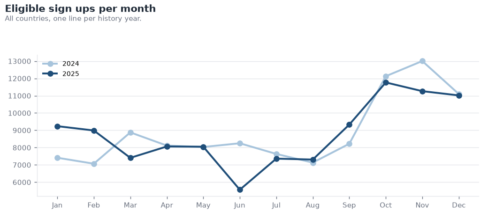
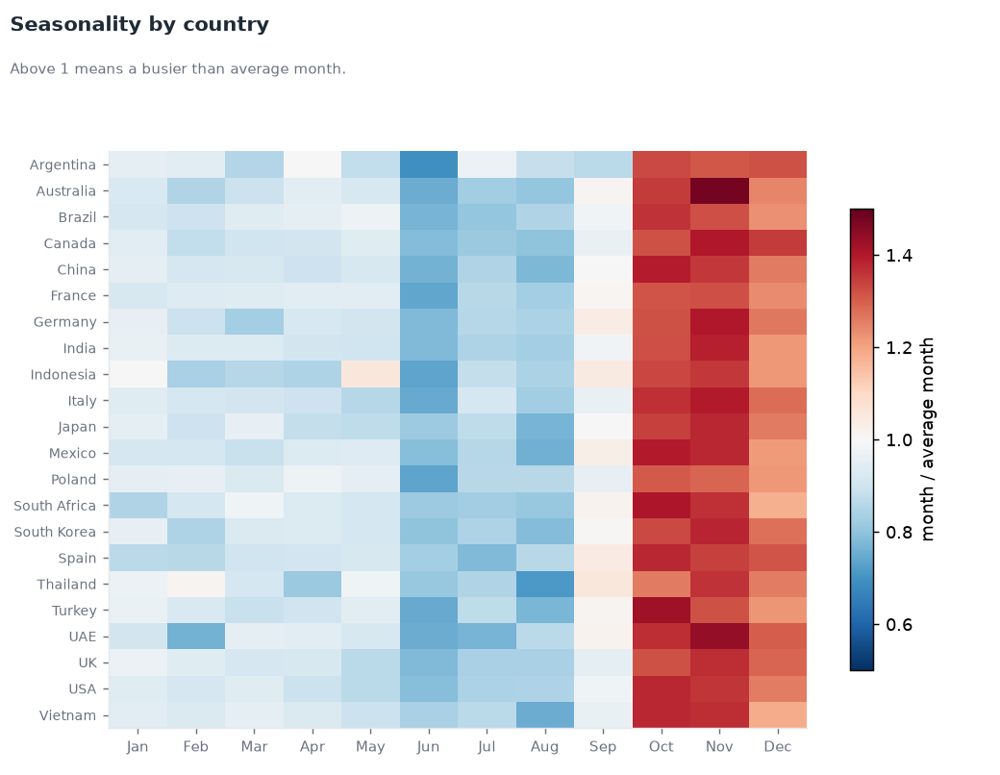
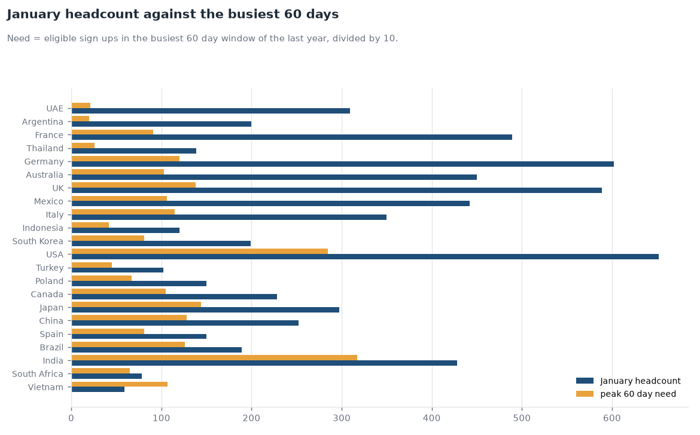
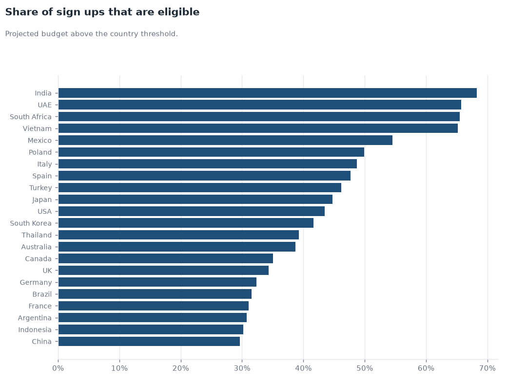
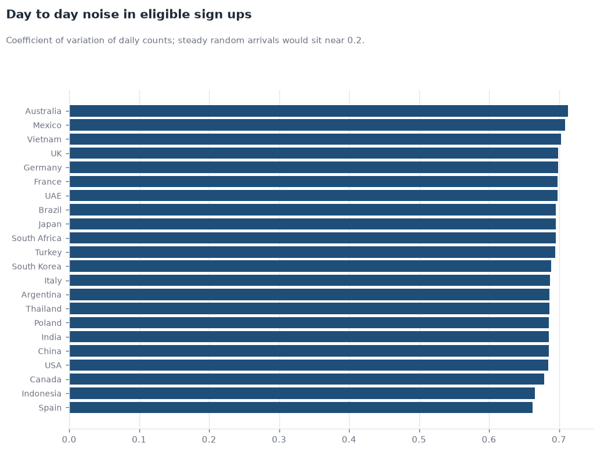
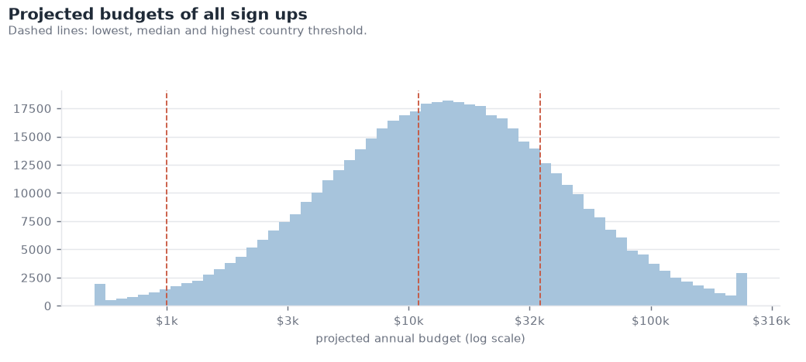

# Exploratory data analysis

Source `DADS5250_Hackathon_Google_Data.xlsx`, history years [2024, 2025], planning year 2026.

## Findings

* 42.5% of 499,644 sign ups clear their country threshold.
* January headcount is 6,474 agents against a peak need of about 2,333, 2.8 times what the busiest 60 days require.
* Demand peaks in Nov and is lowest in Jun; the peak month is 1.8 times the quietest.
* Day to day noise is high: the median daily coefficient of variation is 0.69, far above what steady random arrivals would give, so the waiting pool matters.
* Understaffed in January: Vietnam.
* Eligible sign ups changed by -1.8% (median country) between the two years.
* Weekdays differ by only 12% from each other, so weekly patterns can be ignored.

## Data quality

| check | value | note |
|---|---|---|
| Rows | 499,644 | one row per sign up |
| Missing values | 0 | across all columns |
| Duplicate advertiser ids | 0 |  |
| Impossible dates repaired | 0 | moved to the last day of the month |
| Budgets at or below zero | 0 |  |
| Budgets exactly on the threshold | 13 | ineligible under the strict rule |
| Countries | 22 |  |

## Countries

| country | signups | eligible | eligible_rate | median_eligible_budget | salary | threshold | agents | peak_need | staff_to_need | yearly_change | daily_cv |
|---|---|---|---|---|---|---|---|---|---|---|---|
| Argentina | 5,869 | 1,803 | 0.307 | 8,428 | 18,687 | 5,000 | 200 | 20 | 10 | -0.021 | 0.686 |
| Australia | 23,966 | 9,271 | 0.387 | 28,349 | 43,505 | 16,000 | 450 | 103 | 4.369 | -0.025 | 0.713 |
| Brazil | 36,290 | 11,444 | 0.315 | 48,732 | 27,950 | 29,000 | 189 | 126 | 1.5 | -0.019 | 0.696 |
| Canada | 26,900 | 9,425 | 0.35 | 35,028 | 61,060 | 20,000 | 228 | 105 | 2.171 | -0.041 | 0.679 |
| China | 39,137 | 11,599 | 0.296 | 55,488 | 22,265 | 33,000 | 252 | 128 | 1.969 | -0.011 | 0.685 |
| France | 26,859 | 8,351 | 0.311 | 37,326 | 65,384 | 22,000 | 489 | 91 | 5.374 | -0.029 | 0.698 |
| Germany | 33,183 | 10,744 | 0.324 | 43,967 | 51,328 | 26,000 | 602 | 120 | 5.017 | 0.002 | 0.699 |
| India | 42,330 | 28,886 | 0.682 | 31,687.5 | 14,118 | 13,000 | 428 | 317 | 1.35 | -0.006 | 0.686 |
| Indonesia | 12,110 | 3,658 | 0.302 | 16,674.5 | 15,728 | 10,000 | 120 | 42 | 2.857 | -0.005 | 0.665 |
| Italy | 21,053 | 10,249 | 0.487 | 21,446 | 43,087 | 11,000 | 350 | 115 | 3.043 | -0.003 | 0.687 |
| Japan | 29,865 | 13,359 | 0.447 | 31,366 | 49,545 | 17,000 | 297 | 144 | 2.062 | -0.005 | 0.696 |
| Mexico | 18,140 | 9,897 | 0.546 | 16,625 | 19,789 | 8,000 | 442 | 106 | 4.17 | -0.057 | 0.708 |
| Poland | 12,106 | 6,045 | 0.499 | 11,780 | 38,769 | 6,000 | 150 | 67 | 2.239 | -0.004 | 0.686 |
| South Africa | 9,130 | 5,980 | 0.655 | 6,948.5 | 26,078 | 3,000 | 78 | 65 | 1.2 | -0.035 | 0.695 |
| South Korea | 18,160 | 7,569 | 0.417 | 20,181 | 38,354 | 11,000 | 199 | 81 | 2.457 | -0.023 | 0.688 |
| Spain | 15,127 | 7,218 | 0.477 | 15,353.5 | 33,814 | 8,000 | 150 | 81 | 1.852 | 0.022 | 0.663 |
| Thailand | 6,041 | 2,370 | 0.392 | 7,133.5 | 24,289 | 4,000 | 139 | 26 | 5.346 | 0.04 | 0.686 |
| Turkey | 9,049 | 4,177 | 0.462 | 9,493 | 24,566 | 5,000 | 102 | 45 | 2.267 | -0.019 | 0.695 |
| UAE | 3,014 | 1,982 | 0.658 | 2,418 | 65,115 | 1,000 | 309 | 21 | 14.714 | -0.038 | 0.698 |
| UK | 36,247 | 12,445 | 0.343 | 46,501 | 51,650 | 27,000 | 589 | 138 | 4.268 | -0.022 | 0.699 |
| USA | 60,112 | 26,116 | 0.434 | 65,654 | 77,721 | 35,000 | 652 | 285 | 2.288 | -0.014 | 0.684 |
| Vietnam | 14,956 | 9,746 | 0.652 | 11,675 | 17,904 | 5,000 | 59 | 107 | 0.551 | -0.017 | 0.703 |

## Charts

